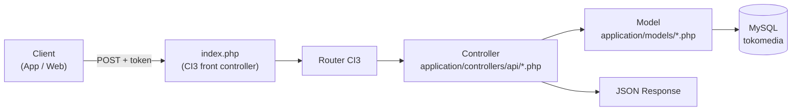

# Dokumentasi API TokoMedia (TM App)

**Sumber kode:** `C:\data\TokoMedia\20261014 API TM App`
**Tanggal analisis:** 15 Oktober 2026
**Terakhir diperbarui:** 19 Oktober 2026 (Prioritas 1, 2 & 3 selesai)
**Tujuan dokumen:** menjelaskan isi API, cara pakainya, dan sejauh mana API ini sudah mencakup kebutuhan website [tokomedia.org](https://www.tokomedia.org/)

---

## 1. Ringkasan

| Item | Nilai |
|---|---|
| Framework | CodeIgniter **3.1.13** (PHP) |
| Struktur | `application/` + `system/` + `assets/` + `index.php` (struktur CI3 standar) |
| Database | MySQL, schema `tokomedia` (dump: `20261014-tokomedia DB Structure and Data.sql`, 27 MB) |
| Jenis API | REST-ish, **POST form-data**, respons JSON |
| Autentikasi | 1 token statis global (`TOKEN`) dikirim sebagai field `token` |
| Jumlah controller API | 11 (`Aplikasi`, `Audio`, `Category`, `Ckitab`, `Contact`, `Ikatan`, `Media`, `Other`, `Riwayat`, `Search`, `Vkitab`) |
| Jumlah endpoint | 40 method publik (di luar `send_email_smtp()` internal) |
| Isi database | 16.586 video, 321 kategori, 275 aplikasi, 640 komentar, 17.107 baris routing |

API ini adalah **backend untuk aplikasi mobile** (Android/iOS) TokoMedia, bukan API untuk website. Website `tokomedia.org` saat ini berjalan dengan aplikasi PHP terpisah (bukan CodeIgniter ini) yang membaca database yang sama.

---

## 2. Arsitektur & Cara Akses

### 2.1 Alur request



### 2.2 Pola URL

CodeIgniter 3 memakai pola `index.php/<controller>/<method>`:

```
https://<host>/<folder-instalasi>/index.php/api/<controller>/<method>
```

Contoh: `https://www.tokomedia.org/api/index.php/api/vkitab/language`

> **Catatan penting:** `application/config/routes.php` **tidak punya route khusus** — hanya default CI3. Jadi URL mengikuti nama class & method apa adanya (huruf kecil semua, karena `translate_uri_dashes = FALSE`).

### 2.3 Base URL yang terkonfigurasi

Dari `application/config/constants.php`:

```php
define('SERVER_URL',       'https://www.tokomedia.org');
define('BASE_URL',         'https://www.tokomedia.org');
define('VIDEO_LINK_S',     'https://61146e7ab7a66.streamlock.net:8089/tokomedia/definst/mp4:');
define('VIDEO_LINK_E',     '/playlist.m3u8');
define('LOCAL_SERVER_URL', 'http://localhost/tokomedia/public/');
define('LOCAL_BASE_URL',   'http://localhost/tokomedia/public/index.php/');
```

`TOKEN` dan konstanta `SMTP_*` **tidak lagi** didefinisikan di `constants.php`.
Nilainya dimuat oleh `application/config/secrets.php` dari environment variable
atau `application/config/secrets.local.php` (lihat bagian 9).

**Status deployment (diverifikasi 15 Okt 2026):** folder API ini **belum terpasang di produksi**. Semua percobaan akses ke `https://www.tokomedia.org/api/...` mengembalikan halaman login website (bukan JSON). Jadi API ini masih tahap pengembangan/lokal.

### 2.4 Cara memanggil (contoh)

```bash
curl -X POST "https://www.tokomedia.org/api/index.php/api/vkitab" \
     -d "token=<token-anda>"
```

```javascript
const TOKEN = "<token-anda>"; // nilai TM_API_TOKEN di server
const res = await fetch(`${BASE}/api/vkitab/language`, {
  method: "POST",
  headers: { "Content-Type": "application/x-www-form-urlencoded" },
  body: new URLSearchParams({ token: TOKEN, id: "144", limit: "20" })
});
const json = await res.json();
```

---

## 3. Konvensi Umum

### 3.1 Autentikasi

Semua endpoint memerlukan field `token` di body POST. Jika salah/kosong:

```json
{ "status": 404, "message": "No Permission", "data": [] }
```

Jika parameter wajib tidak ada:

```json
{ "status": 404, "message": "Parameter is needed", "data": [] }
```

### 3.2 Format respons

```json
{
  "status": 200,
  "message": "Success",
  "data": { }
}
```

`data` bisa berupa **array** (daftar) atau **object** (detail), tergantung endpoint.

### 3.3 Kode `status` internal (BUKAN HTTP status)

| `status` | Arti | Dipakai untuk |
|---|---|---|
| `200` | Success | Berhasil |
| `201` | Peringatan / validasi | Field kurang, bahasa tidak terdaftar, gagal kirim email |
| `404` | Gagal | Token salah, parameter kurang, data tidak ditemukan |

> ⚠️ HTTP status code **selalu 200**. Client harus membaca `status` di dalam JSON, bukan HTTP status.

### 3.4 Parameter umum

| Parameter | Tipe | Wajib | Keterangan |
|---|---|---|---|
| `token` | string | ✅ | Token statis |
| `id` | string/int | tergantung | ID kategori, region, atau bahasa |
| `limit` | int | ❌ | Jumlah maksimum data |
| `offset` | int | ❌ | Mulai dari baris ke-N (default 0) |
| `tag` | string | ❌ | Untuk pencarian tag |

### 3.5 Helper tanggal

`format_indo_date()` di `application/helpers/share_helper.php` mengubah datetime menjadi format `d M Y` (contoh: `2024-08-01 00:13:05` → `01 Aug 24`).

---

## 4. Daftar Endpoint Lengkap

Base: `POST /api/<controller>/<method>`

| # | Controller | Method | Fungsi | Parameter |
|---|---|---|---|---|
| 1 | `aplikasi` | `index` | Daftar region aplikasi | `token` |
| 2 | `aplikasi` | `area` | Daftar aplikasi per region | `token`, `id` |
| 3 | `aplikasi` | `language` | Daftar aplikasi per region (alias `area`) | `token`, `id` |
| 4 | `aplikasi` | `detail` | Detail aplikasi (`counter` atau `slug`) | `token`, `id` |
| 5 | `aplikasi` | `list` | **Semua** aplikasi + pagination + cari + sort | `token`, `page`, `per_page`, `q`, `sort` |
| 6 | `audio` | `index` | Daftar Audio Kitab Suci (root 128) | `token`, `page`, `per_page`, `sort` |
| 7 | `audio` | `area` | Sub-kategori Audio Kitab Suci | `token` |
| 8 | `category` | `index` / `tree` | Pohon kategori lengkap (root → region → bahasa) | `token` |
| 9 | `category` | `languages` | Semua bahasa lintas region untuk satu root | `token`, `id` |
| 10 | `ckitab` | `index` | Daftar Clip Kitab Suci (kategori 131) | `token`, `page`, `per_page`, `sort` |
| 11 | `ckitab` | `detail` | Detail clip + rekomendasi | `token`, `id` |
| 12 | `contact` | `index` | Kirim form kontak + email | `token`, `contactname`, `emailaddress`, `phonenumber`, `messagecontent`, `linkid`, `linkname` |
| 13 | `ikatan` | `index` | Daftar region Film Ikatan Ilahi | `token` |
| 14 | `ikatan` | `area` | Daftar bahasa per region | `token`, `id` |
| 15 | `ikatan` | `language` | Daftar video per kategori | `token`, `id`, `page`, `per_page`, `sort` |
| 16 | `ikatan` | `languagepref` | Daftar video per slug bahasa | `token`, `id`, `page`, `per_page`, `sort` |
| 17 | `media` | `index` | Daftar Media Lainnya (root 129) | `token`, `page`, `per_page`, `sort` |
| 18 | `media` | `area` | Sub-kategori Media Lainnya | `token` |
| 19 | `other` | `index` | Placeholder (data kosong) | `token` |
| 20 | `other` | `latestvideo` | Video terbaru (kategori 2 & 305) | `token`, `page`, `per_page`, `sort` |
| 21 | `other` | `commentvideo` | Kirim komentar video + email | `token`, `contactname`, `emailaddress`, `phonenumber`, `messagecontent`, `videoid`, `videotitle` |
| 22 | `other` | `detailvideo` | Detail video + **increment watchcounter** + rekomendasi | `token`, `id` |
| 23 | `other` | `gettag` | Cari video berdasarkan tag | `token`, `tag`, `page`, `per_page`, `sort` |
| 24 | `other` | `likevideo` | **Increment favoritecounter** (sekali per client) | `token`, `id`, `device_id` |
| 24a | `other` | `detailvideo_readonly` | Detail video **tanpa** increment `watchcounter` | `token`, `id` |
| 25 | `riwayat` | `index` | Daftar region Film Isa Al-Masih | `token` |
| 26 | `riwayat` | `area` | Daftar bahasa per region | `token`, `id` |
| 27 | `riwayat` | `language` | Daftar video per kategori | `token`, `id`, `page`, `per_page`, `sort` |
| 28 | `riwayat` | `languagepref` | Daftar video per slug bahasa | `token`, `id`, `page`, `per_page`, `sort` |
| 29 | `riwayat` | `detail` | Detail video + rekomendasi | `token`, `id` |
| 30 | `search` | `index` / `video` | **Pencarian** judul + deskripsi + tag | `token`, `q`, `page`, `per_page`, `sort` |
| 31 | `vkitab` | `index` | Daftar region Video Kitab Suci | `token` |
| 32 | `vkitab` | `area` | Daftar kitab (id=144) / sub-kategori | `token`, `id` |
| 33 | `vkitab` | `language` | Daftar video per kategori | `token`, `id`, `page`, `per_page`, `sort` |
| 34 | `vkitab` | `languagepref` | Daftar video per slug bahasa | `token`, `id`, `page`, `per_page`, `sort` |
| 35 | `vkitab` | `custom` | Video per kitab (Matius/Markus/Lukas/Yahya/Kisah) | `token`, `id`, `page`, `per_page`, `sort` |
| 36 | `vkitab` | `detail` | Detail video + rekomendasi | `token`, `id` |
| 37 | `welcome` | `index` | Halaman default CI3 (bukan API) | – |

> `contact/infoo` (phpinfo) sudah **dihapus** — lihat bagian 9.

### 4.1 Pagination & sorting (berlaku di semua endpoint daftar)

| Parameter | Keterangan |
|---|---|
| `page` | Nomor halaman, mulai dari 1 |
| `per_page` | Jumlah baris per halaman (maks 100). Default 20 untuk endpoint baru; endpoint lama tanpa `per_page`/`limit` mengembalikan semua baris seperti sebelumnya |
| `limit` / `offset` | Gaya lama, tetap didukung |
| `sort` | `trending` (watchcounter ↓), `popular` (favoritecounter ↓), `newest` (dateschedule ↓), `oldest` (dateschedule ↑), `unseen` (watchcounter ↑), `default` |

Respons daftar menyertakan objek `pagination`:

```json
{
  "status": 200,
  "message": "Success",
  "data": [ ... ],
  "pagination": { "total": 168, "page": 1, "per_page": 20, "has_more": true }
}
```

---

## 5. Detail Endpoint

### 5.1 `aplikasi` — Aplikasi Kitab Suci

#### `POST /api/aplikasi` — Daftar region

**Request:** `token`

**Response:**
```json
{
  "status": 200,
  "message": "Success",
  "data": [
    { "id": "indonesia",  "name": "Indonesia" },
    { "id": "sumatera",   "name": "Sumatera" },
    { "id": "jawa",       "name": "Jawa - Bali - Nusa Tenggara" },
    { "id": "kalimantan", "name": "Kalimantan" },
    { "id": "sulawesi",   "name": "Sulawesi" },
    { "id": "maluku",     "name": "Maluku - Papua" }
  ]
}
```

> `id` di sini berupa **slug string**, berbeda dengan `vkitab`/`riwayat` yang memakai **ID numerik**.

#### `POST /api/aplikasi/area` — Daftar aplikasi per region

**Request:** `token`, `id` (salah satu slug di atas)

**Response:**
```json
{
  "status": 200,
  "message": "Success",
  "data": [
    {
      "name": "Bahasa Muna (2)",
      "url": "https://play.google.com/store/apps/details?id=org.ipsapps.indonesia.muna",
      "thumbnail": "https://www.tokomedia.org/img/appdb/muna.webp",
      "clicked": 0
    }
  ]
}
```

**Sumber data:** tabel `appdb`, difilter lewat kolom `tagging` (`#Sulawesi`, `#Maluku-Papua`, `#Jawa-Bali-NusaTenggara`, `#Kalimantan`, `#Sumatera`, `#Indonesia`).

**Distribusi data `appdb` (269 aktif):**

| Tag | Jumlah |
|---|---|
| `#Sulawesi` | 74 |
| `#Maluku-Papua` | 72 |
| `#Jawa-Bali-NusaTenggara` | 40 |
| `#Kalimantan` | 26 |
| `#Sumatera` | 15 |
| `#Indonesia` / `#indonesia` | 10 |

#### `POST /api/aplikasi/language` — Daftar aplikasi per region (alias `area`)

**Request:** `token`, `id` (slug region)

Respons **identik** dengan `aplikasi/area` (method ini hanya memanggil `area()`),
yaitu `data` berupa array `{ name, url, thumbnail, clicked }`.

#### `POST /api/aplikasi/detail` — Detail aplikasi

**Request:** `token`, `id` (`counter` numerik dari `appdb`)

**Response:**
```json
{
  "status": 200,
  "message": "Success",
  "data": {
    "id": 12,
    "name": "Bahasa Muna (2)",
    "slug": "bahasa-muna-2",
    "description": "…",
    "url": "https://play.google.com/store/apps/details?id=org.ipsapps.indonesia.muna",
    "playstorename": "Bahasa Muna",
    "clicked": 0,
    "tag": "#Sulawesi",
    "thumbnail": "https://www.tokomedia.org/img/appdb/muna.webp"
  }
}
```

> Kedua method ini sebelumnya salah implementasi (copy-paste dari `Vkitab`, memanggil `video_model`). Sekarang memakai `App_model` (`get_app_by_area()` / `get_app_by_id()`).

---

### 5.2 `riwayat` — Film Isa Al-Masih

#### `POST /api/riwayat` — Daftar region

**Response:**
```json
{
  "status": 200,
  "message": "Success",
  "data": [
    { "id": 2, "name": "Indonesia",                 "haschild": 0 },
    { "id": 3, "name": "Sumatera",                  "haschild": 1 },
    { "id": 4, "name": "Jawa, Bali, Nusa Tenggara", "haschild": 1 },
    { "id": 5, "name": "Kalimantan",                "haschild": 1 },
    { "id": 6, "name": "Sulawesi",                  "haschild": 1 },
    { "id": 7, "name": "Maluku, Papua",             "haschild": 1 }
  ]
}
```

`haschild` = 0 berarti region tersebut langsung berisi video (tidak punya sub-bahasa).

#### `POST /api/riwayat/area` — Daftar bahasa per region

**Request:** `token`, `id` (2–7)

**Response:**
```json
{
  "status": 200,
  "message": "Success",
  "data": [
    { "id": 11, "name": "Aceh" },
    { "id": 12, "name": "Batak Toba" }
  ]
}
```

**Jumlah bahasa per region:**

| Region | ID | Jumlah bahasa |
|---|---|---|
| Indonesia | 2 | 0 (langsung video) |
| Sumatera | 3 | 27 |
| Jawa, Bali, Nusa Tenggara | 4 | 34 |
| Kalimantan | 5 | 28 |
| Sulawesi | 6 | 56 |
| Maluku, Papua | 7 | 32 |

#### `POST /api/riwayat/language` — Video per kategori

**Request:** `token`, `id` (ID kategori dari `/area`), `limit`, `offset`

**Response:**
```json
{
  "status": 200,
  "message": "Success",
  "data": [
    {
      "id": 123,
      "name": "01 Pada Mulanya Saat Penciptaan - Indonesia",
      "thumbnail": "https://www.tokomedia.org/img/watch/OT6101.jpg",
      "watchcounter": 39327,
      "duration": "08:09",
      "dateschedule": "01 Apr 21"
    }
  ]
}
```

#### `POST /api/riwayat/languagepref` — Video per slug bahasa

**Request:** `token`, `id` (slug, contoh `aceh`), `limit`

Khusus `id = "indonesia"` akan dipetakan ke kategori 2.

Jika bahasa tidak terdaftar:
```json
{ "status": 201, "message": "Bahasa ini tidak terdaftar di Film Isa Al-Masih", "data": [] }
```

#### `POST /api/riwayat/detail` — Detail video

**Request:** `token`, `id` (seq video)

**Response:**
```json
{
  "status": 200,
  "message": "Success",
  "data": {
    "id": 123,
    "title": "01 Pada Mulanya Saat Penciptaan - Indonesia",
    "content": "Kisah Isa Al-Masih cocok dengan cerita yang lebih besar...",
    "source": "https://61146e7ab7a66.streamlock.net:8089/tokomedia/definst/mp4:1. RIA/RIA Indonesia/01 Pada Mulanya Saat Penciptaan - Indonesia.mp4/playlist.m3u8",
    "duration": "08:09",
    "dateschedule": "01 Apr 21",
    "watchcounter": 39327,
    "tag": "#IsaAlMasih #DubIndonesia #IsaAl-Masih",
    "favcounter": 9168,
    "thumbnail": "https://www.tokomedia.org/img/watch/OT6101.jpg",
    "recomended": [
      {
        "id": 124,
        "title": "02 Kelahiran Isa Al-Masih - Indonesia",
        "duration": "03:44",
        "thumbnail": "https://www.tokomedia.org/img/watch/OT6102.jpg",
        "watchcounter": 2206,
        "dateschedule": "24 Apr 21"
      }
    ]
  }
}
```

> ⚠️ `source` adalah URL **HLS (.m3u8)** dari server Wowza. `sourcelink` di database berisi path dengan spasi (contoh: `1. RIA/RIA Indonesia/01 Pada Mulanya...mp4`) yang **tidak di-encode**, sehingga URL bisa gagal diputar di beberapa player.

---

### 5.3 `vkitab` — Video Kitab Suci

#### `POST /api/vkitab` — Daftar region

```json
{
  "status": 200,
  "message": "Success",
  "data": [
    { "id": "144", "name": "Indonesia",                 "haschild": 1 },
    { "id": "148", "name": "Sumatera",                  "haschild": 1 },
    { "id": "146", "name": "Jawa - Bali - Nusa Tenggara", "haschild": 1 },
    { "id": "149", "name": "Kalimantan",                "haschild": 1 },
    { "id": "147", "name": "Sulawesi",                  "haschild": 1 },
    { "id": "145", "name": "Maluku - Papua",            "haschild": 1 }
  ]
}
```

> `id` di sini **string numerik** (berbeda dengan `aplikasi` yang slug).

#### `POST /api/vkitab/area` — Daftar kitab / sub-kategori

**Request:** `token`, `id`

Jika `id = 144` (Indonesia) → daftar kitab **hardcoded**:
```json
{
  "status": 200,
  "message": "Success",
  "data": [
    { "id": "matius", "name": "Indonesia Matius",              "custom": "yes" },
    { "id": "markus", "name": "Indonesia Markus",              "custom": "yes" },
    { "id": "lukas",  "name": "Indonesia Lukas",               "custom": "yes" },
    { "id": "yahya",  "name": "Indonesia Yahya",               "custom": "yes" },
    { "id": "kisah",  "name": "Indonesia Kisah Para Rasul",    "custom": "yes" }
  ]
}
```

Jika `id` lain → sub-kategori dari tabel `category`:
```json
{ "status": 200, "message": "Success",
  "data": [ { "id": 150, "name": "Alune", "custom": "no" } ] }
```

**Jumlah sub-kategori per region:**

| Region | ID | Jumlah |
|---|---|---|
| Maluku - Papua | 145 | 30 |
| Jawa - Bali - Nusa Tenggara | 146 | 22 |
| Sulawesi | 147 | 39 |
| Sumatera | 148 | 11 |
| Kalimantan | 149 | 5 |

#### `POST /api/vkitab/language` — Video per kategori

**Request:** `token`, `id`, `limit`

#### `POST /api/vkitab/languagepref` — Video per slug bahasa

**Request:** `token`, `id`, `limit`

Khusus `id = "indonesia"` → kategori 144.

#### `POST /api/vkitab/custom` — Video per kitab

**Request:** `token`, `id` = `matius` | `markus` | `lukas` | `yahya` | `kisah`

**Jumlah video per kitab (Bahasa Indonesia):**

| Kitab | Jumlah video |
|---|---|
| Matius | 33 |
| Markus | 34 |
| Lukas | 52 |
| Yahya | 34 |
| Kisah Para Rasul | 56 |

#### `POST /api/vkitab/detail` — Detail video

Sama seperti `riwayat/detail`, ditambah field `dateschedule`.

---

### 5.4 `ckitab` — Clip Kitab Suci

#### `POST /api/ckitab` — Daftar clip

**Request:** `token`, `limit`, `offset`

Kategori **hardcoded = 131** (Clip Kitab Suci Indonesia). Total **39 video**.

**Response:**
```json
{
  "status": 200,
  "message": "Success",
  "data": [
    {
      "id": 1234,
      "name": "Judul Clip",
      "watchcounter": 120,
      "dateschedule": "2024-08-01 00:13:05",
      "duration": "02:30",
      "thumbnail": "https://www.tokomedia.org/img/watch/xxx.jpg"
    }
  ]
}
```

> ⚠️ `dateschedule` di sini **belum diformat** (raw datetime), berbeda dengan endpoint lain yang memakai `format_indo_date()`.

#### `POST /api/ckitab/detail` — Detail clip

Sama seperti `riwayat/detail` + `recomended`.

---

### 5.5 `ikatan` — Film Ikatan Ilahi

#### `POST /api/ikatan` — Daftar region

```json
{
  "status": 200,
  "message": "Success",
  "data": [
    { "id": 305, "name": "Indonesia",                 "haschild": 0 },
    { "id": 306, "name": "Sumatera",                  "haschild": 1 },
    { "id": 307, "name": "Jawa - Bali - Nusa Tenggara", "haschild": 1 },
    { "id": 308, "name": "Kalimantan",                "haschild": 1 },
    { "id": 309, "name": "Sulawesi",                  "haschild": 1 },
    { "id": 310, "name": "Maluku - Papua",            "haschild": 1 }
  ]
}
```

#### `POST /api/ikatan/area` — Daftar bahasa per region

**Request:** `token`, `id`

| Region | ID | Jumlah bahasa |
|---|---|---|
| Sumatera | 306 | 4 |
| Jawa - Bali - Nusa Tenggara | 307 | 2 |
| Sulawesi | 309 | 2 |
| Kalimantan | 308 | 0 |
| Maluku - Papua | 310 | 0 |

#### `POST /api/ikatan/language` — Video per kategori

**Request:** `token`, `id`, `limit`, `offset`

#### `POST /api/ikatan/languagepref` — Video per slug bahasa

**Request:** `token`, `id`, `limit`

Khusus `id = "indonesia"` → kategori 305.

> ⚠️ Controller `Ikatan` **tidak punya method `detail`**. Detail video harus diambil lewat `other/detailvideo`.

---

### 5.6 `other` — Fungsi Umum

#### `POST /api/other/latestvideo` — Video terbaru

**Request:** `token`, `limit`, `offset`

Mengambil video dari kategori **2 (RIA Indonesia)** dan **305 (Ikatan Ilahi Indonesia)**, diurutkan `dateschedule DESC`.

**Response:**
```json
{
  "status": 200,
  "message": "Success",
  "data": [
    {
      "id": 17000,
      "name": "Ikatan Ilahi 12 - Pembaharuan Ikatan - Indonesia",
      "thumbnail": "https://www.tokomedia.org/img/watch/cache/Ikatan Ilahi 12-390x218.jpg",
      "watchcounter": 10222,
      "duration": "10.11",
      "dateschedule": "01 Aug 24"
    }
  ]
}
```

#### `POST /api/other/detailvideo` — Detail video + hitung view

**Request:** `token`, `id`

Berbeda dari `riwayat/detail`: endpoint ini **menaikkan `watchcounter` +1** dan menyimpannya ke database.

```json
{
  "status": 200,
  "message": "Success",
  "data": {
    "id": 17000,
    "title": "Ikatan Ilahi 12 - Pembaharuan Ikatan - Indonesia",
    "content": "...",
    "source": "https://61146e7ab7a66.streamlock.net:8089/.../playlist.m3u8",
    "duration": "10.11",
    "watchcounter": 10223,
    "dateschedule": "01 Aug 24",
    "tag": "#IkatanIlahi",
    "favcounter": 693,
    "thumbnail": "https://www.tokomedia.org/img/watch/cache/...jpg",
    "recomended": [ ]
  }
}
```

#### `POST /api/other/likevideo` — Like video

**Request:** `token`, `id`

Menaikkan `favoritecounter` +1.

```json
{ "status": 200, "message": "Terimakasih telah menyukai video ini", "data": { "totallike": 694 } }
```

> ⚠️ Tidak ada proteksi duplikat — 1 user bisa like berkali-kali.

#### `POST /api/other/gettag` — Cari video berdasarkan tag

**Request:** `token`, `tag`, `limit`, `offset`

Mencari dengan `tagging LIKE '%<tag>%'`.

#### `POST /api/other/commentvideo` — Kirim komentar video

**Request:** `token`, `contactname`, `emailaddress`, `phonenumber`, `messagecontent`, `videoid`, `videotitle`

Menyimpan ke tabel `videocomment` **dan** mengirim email ke `info@tokomedia.org`.

```json
{ "status": 200, "message": "Terimakasih telah meninggalkan Komentar", "data": { } }
```

---

### 5.7 `contact` — Form Kontak

#### `POST /api/contact` — Kirim pesan kontak

**Request:** `token`, `contactname`, `emailaddress`, `phonenumber`, `messagecontent`, `linkid`, `linkname`

```json
{ "status": 200, "message": "Terimakasih telah menghubungi kami. Kami akan segera merespon anda", "data": { } }
```

> ✅ **Sudah diperbaiki:** `Contact_model::insert_contact()` kini menulis ke tabel **`contributor`** (sebelumnya menulis ke tabel `contact` yang tidak ada, sehingga insert selalu gagal).

> ℹ️ Endpoint `contact/infoo` (yang menjalankan `phpinfo()` tanpa autentikasi) sudah **dihapus** dari controller.

---

## 6. Model Data

### 6.1 Tabel yang dipakai API

| Tabel | Baris | Dipakai oleh | Keterangan |
|---|---|---|---|
| `videodb` | 16.586 | semua controller video | Sumber utama video |
| `category` | 321 | `riwayat`, `vkitab`, `ikatan` | Hierarki kategori (self-referencing `parentid`) |
| `appdb` | 275 | `aplikasi` | Daftar aplikasi Android |
| `videocomment` | 640 | `other/commentvideo` | Komentar video |
| `contributor` | 18 | `contact` | Tabel kontak (dipakai `Contact_model`) |
| `apppohon` | 12 | *(tidak dipakai API)* | Aplikasi "Pohon Kehidupan" |
| `routerdb` | 17.107 | *(tidak dipakai API)* | Routing URL website |
| `user`, `user_login` | 4 + 4 | *(tidak dipakai API)* | Admin website |
| `config`, `privileges`, `privilegepath`, `loginschedule`, `newsletter`, `slideshows` | – | *(tidak dipakai API)* | Konfigurasi & admin |

### 6.2 Struktur `videodb`

| Kolom | Tipe | Dipakai API | Keterangan |
|---|---|---|---|
| `seq` | int PK | ✅ | ID video |
| `displayname` | varchar | ✅ | Judul |
| `messagecontent` | text | ✅ | Deskripsi/sinopsis |
| `slug` | varchar | ❌ | URL slug website |
| `youtubelink` | varchar | ❌ | Link YouTube (14.397 video) |
| `embedlink` | varchar | ❌ | ID embed YouTube |
| `sourcelink` | varchar | ✅ | Path file di server Wowza |
| `duration` | varchar | ✅ | Durasi |
| `createddate` | datetime | ❌ | Tanggal dibuat |
| `watchcounter` | bigint | ✅ | Jumlah view |
| `categoryarray` | int | ✅ | FK ke `category.seq` |
| `tagging` | text | ✅ | Tag dipisah spasi |
| `favoritecounter` | bigint | ✅ | Jumlah like |
| `thumbnail` | varchar | ✅ | Path thumbnail |
| `isdeleted` | tinyint | ✅ | Soft delete |
| `datedeleted` | datetime | ❌ | |
| `datemodified` | datetime | ❌ | |
| `dateschedule` | datetime | ✅ | Tanggal tayang |
| `downloadcounter` | bigint | ❌ | Jumlah download |

### 6.3 Struktur `category`

| Kolom | Keterangan |
|---|---|
| `seq` | PK |
| `categoryname` | Nama kategori/bahasa |
| `slug` | Slug URL |
| `description` | Deskripsi |
| `parentid` | Parent (0 = root) |
| `thumbnail` | Path thumbnail |

**Hierarki root:**

| Root | Nama | Jumlah video |
|---|---|---|
| 1 | Film Isa Al-Masih | 11.036 |
| 126 | Video Kitab Suci | 5.401 |
| 304 | Ikatan Ilahi | 110 |
| 127 | Clip Kitab Suci | 39 |
| 128 | Audio Kitab Suci | 0 |
| 129 | Media Lainnya | 0 |
| 125 | Kitab Injil Yahya | 0 |

### 6.4 Struktur `appdb`

| Kolom | Keterangan |
|---|---|
| `counter` | PK |
| `appname` | Nama aplikasi |
| `slug` | Slug |
| `description` | Deskripsi |
| `downloadlink` | Link Play Store |
| `clicked` | Jumlah klik |
| `appimage` | Path gambar |
| `createddate`, `datemodified`, `datedeleted` | Timestamp |
| `isdeleted` | Soft delete |
| `tagging` | Tag region (`#Sulawesi`, dll) |
| `playstorename` | Nama di Play Store |

---

## 7. Peta Data: API vs Website tokomedia.org

### 7.1 Halaman website yang ada

| Halaman website | URL | Sumber data |
|---|---|---|
| Home | `/` | `category`, `videodb` |
| Film Isa Al-Masih (semua bahasa) | `/film-riwayat-isa-al-masih` | `category` |
| Film Isa Al-Masih per bahasa | `/film-riwayat-isa-al-masih/{slug}` | `videodb` |
| Tonton video | `/film-riwayat-isa-al-masih/{slug}/w/{video-slug}` | `videodb` |
| Film Ikatan Ilahi | `/film-ikatan-ilahi` | `category` |
| Film Ikatan Ilahi per bahasa | `/film-ikatan-ilahi/{slug}` | `videodb` |
| Video Kitab Suci | `/film-kitab-suci-injil` | `category` |
| Video Kitab Suci per kitab | `/video-kitab-suci/indonesia/injil-suci-matius` | `videodb` (tag) |
| Clip Kitab Suci | `/clip/indonesia` | `videodb` |
| Koleksi Aplikasi | `/koleksi-aplikasi` | `appdb` |
| Detail Aplikasi | `/app/p/{slug}` | `appdb` |
| Kontak | `/contact` | `contributor` |
| Pencarian | `/search/v/?v={query}` | `videodb` |
| Admin | `/manage/*`, `/master/*` | semua tabel |

### 7.2 Matriks cakupan API

| Kebutuhan website | Endpoint API | Status |
|---|---|---|
| Home – daftar kategori utama | – | ❌ **Tidak ada** |
| Home – daftar bahasa (letter grid) | `category/languages` | ✅ Semua bahasa lintas region |
| Home – tayangan terbaru | `other/latestvideo` | ✅ Ada (hanya kategori 2 & 305) |
| Film Isa Al-Masih – region | `riwayat` | ✅ |
| Film Isa Al-Masih – bahasa | `riwayat/area` | ✅ |
| Film Isa Al-Masih – daftar video | `riwayat/language`, `riwayat/languagepref` | ✅ |
| Film Isa Al-Masih – detail video | `riwayat/detail` | ✅ |
| Film Ikatan Ilahi – region | `ikatan` | ✅ |
| Film Ikatan Ilahi – bahasa | `ikatan/area` | ✅ |
| Film Ikatan Ilahi – daftar video | `ikatan/language`, `ikatan/languagepref` | ✅ |
| Film Ikatan Ilahi – detail video | – | ⚠️ Pakai `other/detailvideo` |
| Video Kitab Suci – region | `vkitab` | ✅ |
| Video Kitab Suci – bahasa | `vkitab/area` | ✅ |
| Video Kitab Suci – daftar video | `vkitab/language`, `vkitab/languagepref` | ✅ |
| Video Kitab Suci – per kitab | `vkitab/custom` | ✅ |
| Video Kitab Suci – detail video | `vkitab/detail` | ✅ |
| Clip Kitab Suci – daftar | `ckitab` | ✅ |
| Clip Kitab Suci – detail | `ckitab/detail` | ✅ |
| Aplikasi – daftar per region | `aplikasi/area` | ✅ |
| Aplikasi – **semua** aplikasi | `aplikasi/list` | ✅ Dengan pagination & pencarian |
| Aplikasi – detail aplikasi | `aplikasi/detail` | ✅ (`counter` atau `slug`) |
| Kontak – kirim pesan | `contact` | ✅ |
| Komentar video | `other/commentvideo` | ✅ |
| Like video | `other/likevideo` | ✅ |
| Pencarian | `other/gettag` | ⚠️ Hanya by tag |
| Pencarian (seperti website) | `search` | ✅ Judul + deskripsi + tag |
| Kebijakan Privasi | – | ❌ Tidak ada (statis di UI) |
| Audio Kitab Suci | `audio` | ✅ (kategori 128 masih kosong di DB) |
| Media Lainnya | `media` | ✅ (kategori 129 masih kosong di DB) |
| Admin / manajemen konten | – | ❌ Tidak ada (di luar cakupan) |

### 7.3 Ringkasan kesenjangan

**Sudah tercakup (≈70%):** seluruh alur tonton video (4 kategori konten), daftar bahasa per region, detail video + rekomendasi, komentar, like, aplikasi per region.

**Belum tercakup:**

1. **Detail video tanpa menambah view** — `other/detailvideo` selalu menambah `watchcounter`; tidak ada varian "read-only".
2. **Kebijakan Privasi** — masih statis di UI, belum ada endpoint.
3. **Admin / manajemen konten** — di luar cakupan API mobile.

> Item "semua bahasa", "semua aplikasi", "pencarian", "kategori utama", "audio/media", "sorting", dan "pagination metadata" sudah tersedia — lihat bagian 9 Prioritas 2.

---

## 8. Catatan Teknis & Risiko

### 8.1 Keamanan

| # | Tingkat | Temuan | Lokasi | Status |
|---|---|---|---|---|
| 1 | 🔴 Kritis | `phpinfo()` terbuka tanpa autentikasi | `Contact::infoo()` | ✅ Dihapus |
| 2 | 🔴 Kritis | Kredensial SMTP hardcoded di source code | `Contact::send_email_smtp()`, `Other::send_email_smtp()` | ✅ Dipindah ke `secrets.php` |
| 3 | 🔴 Kritis | Token API hardcoded & dipakai bersama semua client | `constants.php` | ✅ Dipindah ke `secrets.php` |
| 4 | 🟠 Tinggi | SQL injection via `LIKE` tanpa escaping | `Video_model::get_vkitab_by_book()`, `get_by_tag()` | ✅ Pakai query builder `like()` |
| 5 | 🟠 Tinggi | SQL injection via subquery string concat | `Category_model::get_category_name_by_pref()` | ✅ Pakai `get_compiled_select()` |
| 6 | 🟡 Sedang | Password hash SHA-1 tanpa salt | tabel `user_login` | ✅ Library `Password_hash` + migrasi SQL |
| 7 | 🟡 Sedang | Tidak ada rate limiting pada `likevideo` / `detailvideo` | `Other` | ✅ `api_rate_limit()` |
| 8 | 🟡 Sedang | Tidak ada validasi format email/telepon | `Contact`, `Other::commentvideo` | ✅ `api_validate_*()` |
| 9 | ⚪ Rendah | `db_debug` aktif saat non-production | `database.php` | ✅ `ENVIRONMENT !== 'production'` |

### 8.2 Bug fungsional

| # | Bug | Lokasi | Status |
|---|---|---|---|
| 1 | `aplikasi/language` & `aplikasi/detail` mengembalikan data video | `Aplikasi.php` | ✅ Diperbaiki |
| 2 | `contact` menulis ke tabel `contact` yang tidak ada | `Contact_model.php` | ✅ Diperbaiki |
| 3 | `Videocomment_model::get_by_videoid()` memanggil `fresult_array()` (typo) | `Videocomment_model.php` | ✅ Diperbaiki |
| 4 | `Video_model::delete_video()` menghapus dari tabel `video` (bukan `videodb`) | `Video_model.php` | ✅ Diperbaiki |
| 5 | `ckitab` tidak memformat `dateschedule` | `Ckitab.php` | ✅ Diperbaiki |
| 6 | `Ikatan` tidak punya method `detail` | `Ikatan.php` | ✅ Diperbaiki |
| 7 | `Aplikasi::index` mendefinisikan `$response` dua kali (dead code) | `Aplikasi.php` | ✅ Diperbaiki |
| 8 | `Category_model::get_category_name_by_pref()` error jika hasil kosong (`$result['seq']` pada `null`) | `Category_model.php` | ✅ Diperbaiki |
| 9 | `sourcelink` tidak di-URL-encode saat membentuk `source` | semua controller detail | ✅ Diperbaiki |
| 10 | `MY_Controller` memuat `user_model` yang tidak ada di folder models | `MY_Controller.php` | ✅ Diperbaiki |

### 8.3 Catatan implementasi

- **Tidak ada `routes.php` kustom** → URL bergantung nama class/method. Kalau ingin `api/v1/...`, perlu tambah route.
- **Tidak ada `.htaccess` di root** → URL harus menyertakan `index.php` kecuali server dikonfigurasi lain.
- **`autoload`** memuat helper `url`, `template`, `form`, `share`, `api` dan library `session` di setiap request.
- **`helpers/api_helper.php`** menyediakan `api_require_token()`, `api_out()`, `api_page_params()`, `api_pagination()`, `api_sort()`, `api_apply_sort()`, `api_video_item()`, `api_app_item()`, `api_iso_date()`, `api_video_source()`, `api_validate_email()`, `api_validate_phone()`, `api_validate_length()`, `api_client_id()`, `api_rate_limit()` — dipakai controller agar format respons konsisten.
- **`libraries/Password_hash.php`** — verifikasi + upgrade otomatis hash SHA-1 lama ke argon2id/bcrypt.
- **`database/20261019_priority3.sql`** — migrasi tabel `videolike` dan kolom `user_login.password`/`password_algo`.
- **`docs/openapi.yaml`** — spesifikasi OpenAPI 3.0.3 untuk seluruh endpoint.
- **`config.php`**: `base_url` kosong, `index_page = 'index.php'`, `encryption_key` kosong.
- **`database.php`**: kredensial masih placeholder (`root` / `YourmySQLipasswordhere`) — perlu diisi saat deploy.
- **`composer.json`** hanya mendeklarasikan CodeIgniter framework; tidak ada dependency tambahan.

---

## 9. Rekomendasi

### Prioritas 1 — Sebelum deploy ✅ **SELESAI**

| # | Item | Status |
|---|---|---|
| 1 | Hapus `Contact::infoo()` | ✅ |
| 2 | Pindahkan kredensial SMTP & token ke environment variable / file config | ✅ |
| 3 | Perbaiki `Contact_model` agar menulis ke tabel `contributor` | ✅ |
| 4 | Perbaiki `aplikasi/language` & `aplikasi/detail` agar memakai `App_model` | ✅ |
| 5 | Tambahkan escaping pada semua query `LIKE` dan subquery | ✅ |

#### Cara mengatur kredensial (WAJIB dibaca sebelum deploy)

Kredensial **tidak lagi** ditulis di source code. Nilainya dibaca oleh
`application/config/secrets.php` dengan urutan prioritas:

1. **Environment variable** (disarankan untuk produksi)
2. **`application/config/secrets.local.php`** (untuk lokal, **tidak di-commit** — sudah masuk `.gitignore`)
3. Nilai default (kosong / `587` / `tls` / `Mobile Apps`)

| Environment variable | Keterangan |
|---|---|
| `TM_API_TOKEN` | Token API global (field `token`) |
| `TM_SMTP_HOST` | Host SMTP |
| `TM_SMTP_PORT` | Port SMTP (default `587`) |
| `TM_SMTP_USER` | User SMTP |
| `TM_SMTP_PASS` | Password SMTP |
| `TM_SMTP_CRYPTO` | `tls` / `ssl` (default `tls`) |
| `TM_SMTP_FROM` | Alamat pengirim |
| `TM_SMTP_FROM_NAME` | Nama pengirim (default `Mobile Apps`) |
| `TM_SMTP_TO` | Alamat tujuan notifikasi |

Jika `TM_API_TOKEN` kosong, **semua endpoint menolak request** (`status: 404`,
`No Permission`) — ini disengaja agar aman secara default. Jika kredensial SMTP
kosong, pengiriman email gagal dan API mengembalikan `status: 201`.

Contoh `secrets.local.php` (buat manual di server, jangan di-commit):

```php
<?php
defined('BASEPATH') or exit('No direct script access allowed');

return array(
	'TM_API_TOKEN'   => 'token-rahasia-anda',
	'TM_SMTP_HOST'   => 'smtp.contoh.com',
	'TM_SMTP_PORT'   => 587,
	'TM_SMTP_USER'   => 'info@contoh.com',
	'TM_SMTP_PASS'   => 'password-smtp',
	'TM_SMTP_CRYPTO' => 'tls',
	'TM_SMTP_FROM'   => 'info@contoh.com',
	'TM_SMTP_TO'     => 'info@contoh.com',
);
```

> ⚠️ **Token lama** (`TOKEN_LAMA…`) sudah pernah terekspos di source code & riwayat Git.
> Sebaiknya **ganti dengan token baru** saat deploy.

### Prioritas 2 — Agar API bisa menggantikan website ✅ **SELESAI**

| # | Item | Endpoint | Status |
|---|---|---|---|
| 6 | Pohon kategori untuk home page | `category/index`, `category/tree` | ✅ |
| 7 | Semua aplikasi + pagination & detail | `aplikasi/list`, `aplikasi/detail` | ✅ |
| 8 | Pencarian judul + deskripsi + tag | `search/index`, `search/video` | ✅ |
| 9 | Semua bahasa lintas region | `category/languages` | ✅ |
| 10 | Controller Audio & Media (kategori 128 & 129) | `audio/*`, `media/*` | ✅ |
| 11 | Metadata pagination di semua respons daftar | semua endpoint daftar | ✅ |
| 12 | Parameter `sort` (trending/popular/newest/oldest/unseen) | semua endpoint daftar | ✅ |

#### Contoh pemakaian endpoint baru

```bash
# Pohon kategori (root -> region -> bahasa)
curl -X POST "$BASE/category/tree" -d "token=$TOKEN"

# Semua bahasa Film Isa Al-Masih (168 bahasa)
curl -X POST "$BASE/category/languages" -d "token=$TOKEN&id=1"

# Semua aplikasi, halaman 2, 50 per halaman, urut terpopuler
curl -X POST "$BASE/aplikasi/list" \
     -d "token=$TOKEN&page=2&per_page=50&sort=popular"

# Detail aplikasi lewat slug
curl -X POST "$BASE/aplikasi/detail" -d "token=$TOKEN&id=bahasa-muna-2"

# Pencarian
curl -X POST "$BASE/search" -d "token=$TOKEN&q=matius&sort=trending"

# Audio & Media
curl -X POST "$BASE/audio" -d "token=$TOKEN&per_page=20"
curl -X POST "$BASE/media" -d "token=$TOKEN&per_page=20"
```

> **Catatan `category/languages`:** jumlah bahasa per root mengikuti isi database —
> Film Isa Al-Masih **169**, Video Kitab Suci **103**, Ikatan Ilahi **11**.
> Region yang tidak punya sub-bahasa (mis. "Indonesia") dihitung sebagai bahasa itu
> sendiri. `category/languages` mengembalikan **semua** bahasa lintas region (bukan
> hanya 100 seperti `homeLanguages` di UI).

### Prioritas 3 — Perbaikan kualitas ✅ **SELESAI**

| # | Item | Implementasi | Status |
|---|---|---|---|
| 13 | Standarkan format tanggal | `dateschedule` (Indonesia) + `dateschedule_iso` (ISO 8601) di semua respons | ✅ |
| 14 | `detail` di controller `Ikatan` | `ikatan/detail` | ✅ |
| 15 | Detail video tanpa increment view | `other/detailvideo_readonly` | ✅ |
| 16 | Proteksi duplikat like | tabel `videolike` + `device_id`/IP | ✅ |
| 17 | Validasi input | `api_validate_email/phone/length()` di `contact` & `other/commentvideo` | ✅ |
| 18 | Rate limiting | `api_rate_limit()` — like 30/menit, komentar 10/5 menit | ✅ |
| 19 | Hash password modern | `application/libraries/Password_hash.php` + migrasi SQL | ✅ |
| 20 | Dokumentasi OpenAPI | `docs/openapi.yaml` (OpenAPI 3.0.3, 40 path) | ✅ |

#### Migrasi database (WAJIB sebelum deploy)

Jalankan sekali pada database `tokomedia`:

```bash
mysql -u <user> -p tokomedia < "20261014 API TM App/database/20261019_priority3.sql"
```

Migrasi membuat tabel `videolike` dan memperlebar kolom `user_login.password`
menjadi `varchar(255)` + menambah kolom `password_algo`.

#### Format tanggal

Semua respons yang memuat tanggal kini menyediakan dua bentuk:

```json
{
  "dateschedule": "01 Apr 2021",
  "dateschedule_iso": "2021-04-01T14:06:00+07:00"
}
```

`dateschedule` dipertahankan agar client lama tidak rusak; `dateschedule_iso`
untuk parsing/sorting di client baru. Nilai `0000-00-00` menjadi `null`.

#### Proteksi duplikat like

`other/likevideo` menerima `device_id` (opsional). Bila kosong, server memakai
hash IP + User-Agent. Satu client hanya bisa like sekali per video:

```json
{ "status": 201, "message": "Anda sudah menyukai video ini", "data": { "totallike": 9169 } }
```

#### Rate limiting

Berbasis file di `application/cache/ratelimit_*.json` (sudah masuk `.gitignore`).
Bila folder cache tidak bisa ditulis, rate limit otomatis dilewati agar API
tetap berjalan.

#### Upgrade hash password

```php
$this->load->library('password_hash');
$r = $this->password_hash->verify_and_upgrade($input, $row['password'], $row['password_algo']);
if ($r['valid'] && $r['upgraded']) {
    // simpan $r['hash'] ke kolom password, $r['algo'] ke password_algo
}
```

Hash SHA-1 lama tetap bisa diverifikasi dan otomatis di-upgrade ke
argon2id/bcrypt saat login berikutnya.

#### Dokumentasi OpenAPI

`20261014 API TM App/docs/openapi.yaml` — dapat dibuka di Swagger Editor,
Postman, atau Redoc. Catatan: karena API memakai `POST` form-data, parameter
`token` didokumentasikan sebagai parameter form.

---

## 10. Lampiran — Contoh Pemakaian Lengkap

### Alur: menampilkan Film Isa Al-Masih bahasa Aceh

```javascript
const BASE  = "https://www.tokomedia.org/api/index.php/api";
const TOKEN = "<token-anda>"; // nilai TM_API_TOKEN di server

const post = (path, body) =>
  fetch(`${BASE}/${path}`, {
    method: "POST",
    headers: { "Content-Type": "application/x-www-form-urlencoded" },
    body: new URLSearchParams({ token: TOKEN, ...body })
  }).then(r => r.json());

// 1. Ambil daftar region
const regions = await post("riwayat", {});
// → [{ id: 2, name: "Indonesia", haschild: 0 }, { id: 3, name: "Sumatera", haschild: 1 }, ...]

// 2. Ambil bahasa di region Sumatera (id=3)
const langs = await post("riwayat/area", { id: 3 });
// → [{ id: 11, name: "Aceh" }, ...]

// 3. Ambil video bahasa Aceh (id=11)
const videos = await post("riwayat/language", { id: 11, limit: 20, offset: 0 });

// 4. Ambil detail video
const detail = await post("riwayat/detail", { id: videos.data[0].id });
// → { data: { title, content, source, duration, watchcounter, recomended: [...] } }
```

### Alur: menampilkan aplikasi region Sulawesi

```javascript
const areas = await post("aplikasi", {});
// → [{ id: "sulawesi", name: "Sulawesi" }, ...]

const apps = await post("aplikasi/area", { id: "sulawesi" });
// → [{ name, url, thumbnail, clicked }, ...]  (74 aplikasi)
```

### Alur: kirim komentar video

```javascript
await post("other/commentvideo", {
  contactname:    "Nama Pengguna",
  emailaddress:   "user@example.com",
  phonenumber:    "+628123456789",
  messagecontent: "Video ini sangat memberkati.",
  videoid:        17000,
  videotitle:     "Ikatan Ilahi 12 - Pembaharuan Ikatan - Indonesia"
});
```

---

## 11. Integrasi UI Web (`index.html`)

Halaman `index.html` di root repositori kini memakai API sebagai sumber data utama,
dengan data tertanam (`window.TM_PAYLOAD`) sebagai cadangan bila API tidak terjangkau.

### 11.1 Konfigurasi

```javascript
var TM_CONFIG = {
  apiBase: 'https://www.tokomedia.org/api/index.php/api',
  token:   '<TOKEN>'
};
```

- `apiBase` dapat ditimpa lewat query string untuk pengujian lokal:
  `index.html?api=http://127.0.0.1:8099/api`
- Semua permintaan dikirim sebagai `POST` dengan `application/x-www-form-urlencoded`
  melalui helper `apiPost(path, params)`.

### 11.2 Peta menu UI → endpoint

| Menu UI | Slug rute | Root kategori | Endpoint daftar bahasa | Endpoint daftar video |
|---|---|---|---|---|
| Film Isa Al-Masih | `film-riwayat-isa-al-masih` | 1 | `category/tree` | `riwayat/languagepref` |
| Video Kitab Suci | `video` | 126 | `category/tree` | `vkitab/languagepref` |
| Clip Kitab Suci | `clip` | 127 | `category/tree` | `ckitab/index` |
| Film Ikatan Ilahi | `film-ikatan-ilahi` | 304 | `category/tree` | `ikatan/languagepref` |
| Aplikasi Kitab Suci | `app` | — | — | `aplikasi/list` |
| Tayangan Pilihan Terbaru | — | — | — | `other/latestvideo` |
| Pencarian | — | — | — | `search` |
| Detail video | — | — | — | `other/detailvideo_readonly` |
| Suka video | — | — | — | `other/likevideo` |
| Form kontak | — | — | — | `contact` |
| Tanggapan video | — | — | — | `other/commentvideo` |

Catatan penempatan data:

- **Beranda** — indeks A–Z dan galeri ikon hanya memakai bahasa dari root **1**
  (Film Isa Al-Masih), sesuai desain awal. Kategori lain punya daftar bahasanya
  sendiri di halaman wilayah.
- **Halaman wilayah** — anak root yang bernama `Indonesia` selalu ditampilkan
  sebagai accordion **Indonesia (Bahasa Nasional)** di posisi teratas, bukan
  sebagai wilayah kepulauan. Accordion wilayah default tertutup.
- **Clip Kitab Suci** — hanya punya satu kategori (`clip/indonesia`, id 131),
  sehingga endpoint `ckitab/index` tidak menerima parameter bahasa.
- **Kebijakan Privasi** — masih memakai data tertanam karena belum ada endpoint-nya.

### 11.3 Field `slug` pada respons video

Seluruh respons daftar video dan detail video kini menyertakan `slug`
(mis. `film-riwayat-isa-al-masih/aceh/w/riwayat-isa-al-masih`). UI memakainya
untuk membentuk tautan "tonton di website" dan menentukan nama bahasa pada
halaman detail.

---

*Dokumen ini dibuat berdasarkan analisis statis kode sumber dan dump database per 15 Oktober 2026.*
