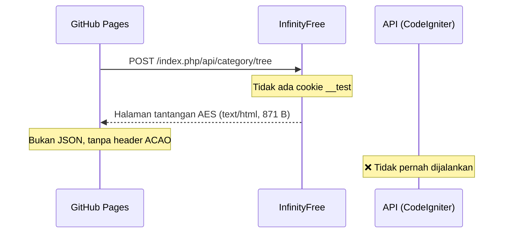
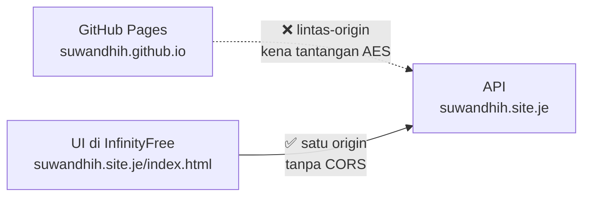

# Temuan: API TokoMedia tidak bisa dipanggil dari GitHub Pages

**Tanggal:** 20 Oktober 2026
**Status:** ✅ Akar masalah **terbukti** — bukan soal CORS

---

## Ringkasan singkat

UI di <https://suwandhih.github.io/TokoMedia/> tidak bisa menarik data dari API di
`https://suwandhih.site.je/index.php/api`. Console browser melaporkan error CORS.

Setelah diperiksa langsung, **penyebabnya bukan konfigurasi API**. Konfigurasi
CORS di server sudah **100% benar dan terbukti bekerja**. Yang menghalangi adalah
**tantangan JavaScript AES** yang dipasang InfinityFree di depan seluruh akun —
sebuah mekanisme anti-bot. Tantangan itu membuat browser tidak pernah sampai ke
PHP, sehingga header CORS tidak pernah dikirim.

> **Kesimpulan:** tidak ada satu baris pun di `config.php`, `hooks.php`,
> `.htaccess`, atau `Api_cors.php` yang perlu diubah. Masalahnya di **pilihan
> host**, bukan di kode.

---

## Bukti 1 — berkas di server sudah versi baru

Diperiksa lewat File Manager InfinityFree:

| Berkas | Ukuran di server | Isi |
|---|---|---|
| `application/config/config.php` | 19,33 KB | ✅ ada `$config['cors_origins']` |
| `application/config/hooks.php` | 772 B | ✅ ada hook `Api_cors` |
| `application/hooks/Api_cors.php` | 1,31 KB | ✅ berkas ada |

Jadi tidak ada berkas yang ketinggalan versi.

---

## Bukti 2 — balasan pertama bukan JSON, tapi halaman tantangan

Permintaan normal ke API membalas:

| Yang diperiksa | Nilai |
|---|---|
| Status | `200 OK` (menyesatkan — bukan dari API) |
| `Content-Type` | `text/html` ← **bukan** `application/json` |
| Panjang isi | `871` byte |
| `Server` | `openresty` |
| `Access-Control-Allow-Origin` | **tidak ada** |

Isi 871 byte itu adalah halaman JavaScript milik InfinityFree:

```html
<script type="text/javascript" src="/aes.js"></script>
<script>
  ...
  document.cookie = "__test=" + toHex(slowAES.decrypt(c, 2, a, b)) + "; ...";
  location.href = "https://suwandhih.site.je/index.php/api/category/tree?i=1";
</script>
```

Artinya: permintaan **dijawab oleh InfinityFree**, bukan oleh API.

---

## Bukti 3 — kalau tantangan diselesaikan, API menjawab sempurna

Tantangan itu adalah AES-128-CBC. Setelah nilai `__test` dihitung dan dikirim
sebagai cookie, balasan berubah menjadi:

| Header balasan | Nilai |
|---|---|
| `Content-Type` | `application/json` ✅ |
| `Access-Control-Allow-Origin` | `https://suwandhih.github.io` ✅ |
| `Access-Control-Allow-Methods` | `POST, GET, OPTIONS` ✅ |
| `Access-Control-Allow-Headers` | `Content-Type, X-Requested-With` ✅ |
| `Access-Control-Max-Age` | `86400` ✅ |
| Panjang isi | **68.819 byte JSON asli** ✅ |

**Ini membuktikan CORS sudah bekerja.** Hook `Api_cors` memang jalan dan mengirim
header yang benar — tetapi hanya kalau permintaan berhasil melewati tantangan.

---

## Kenapa browser tidak bisa melewatinya

Untuk mendapat cookie `__test`, browser harus **lebih dulu** menjalankan
`/aes.js` dari halaman tantangan. Permintaan lintas-origin dari GitHub Pages
tidak memiliki cookie itu, jadi yang diterima selalu halaman tantangan.

Urutannya:



---

## Tantangan ini menyeluruh satu akun

Diuji pada beberapa jenis alamat:

| Yang diuji | `Content-Type` | Panjang | ACAO |
|---|---|---|---|
| `http://suwandhih.site.je/.../category/tree` | `text/html` | 870 | tidak |
| `https://suwandhih.site.je/.../category/tree` | `text/html` | 871 | tidak |
| `https://suwandhih.site.je/.../category/tree?i=1` | `text/html` | 871 | tidak |
| `https://suwandhih.site.je/` (halaman statis) | `text/html` | 844 | tidak |
| `https://suwandhih.site.je/DEPLOY.md` (berkas statis) | `text/html` | 853 | tidak |

Karena berkas statis pun kena, tantangan ini **bukan** soal PHP atau `.htaccess`.
Ia berdiri di depan seluruh akun.

---

## Server client tidak terpengaruh

| Alamat | IP | Server |
|---|---|---|
| `tokomedia.org` | `103.23.201.26` | Apache/2.2.15 (CentOS) |
| `suwandhih.site.je` (InfinityFree) | `185.27.134.125` | openresty |

Tantangan AES hanya menimpa host uji InfinityFree.

---

## Yang bisa dilakukan

| # | Cara | Perlu apa | Peluang berhasil |
|---|---|---|---|
| **1** | ~~Pasang **Cloudflare** di depan domain~~ | — | ❌ **Tidak mungkin** — `site.je` subdomain gratis InfinityFree, NS-nya milik InfinityFree (`ns1.byet.org` dll). Cloudflare butuh kontrol NS domain induk. |
| **2** | **Pindah ke host gratis lain** | Ekspor DB (±26 MB) + unggah ulang | Besar |
| **3** | **XAMPP di laptop** untuk demo | Instal XAMPP | Pasti jalan, tapi hanya lokal/LAN |
| **4** | Pakai **API live client** (`tokomedia.org:8009`) | Client menambah CORS + endpoint `category/tree` & `aplikasi/list` | Bergantung client |
| **5** | Biarkan apa adanya | — | UI tetap tampil, tapi pakai data tertanam |
| **6** | ⭐ **Taruh UI di InfinityFree, satu origin dengan API** | Unggah `index.html` 208 KB | ✅ **Sudah terbukti jalan** |

**Catatan:** UI **tidak rusak** walau API gagal. Setiap panggilan API punya
penangan `.catch()` yang jatuh ke data tertanam, jadi halaman tetap tampil.

---

## ⭐ Temuan tambahan: tantangan AES bisa dilewati — asal satu origin

Tantangan AES **hanya** menghalangi permintaan **lintas-origin**. Bila halaman
UI dibuka dari origin yang sama dengan API, browser sudah menyelesaikan
tantangan saat memuat halaman, lalu permintaan API lolos.

**Bukti — Console dibuka di `https://suwandhih.site.je/` lalu panggil API:**

| Yang diperiksa | Hasil |
|---|---|
| `origin` | `https://suwandhih.site.je` |
| Cookie `__test` ada? | ✅ ya (dibuat browser saat halaman dimuat) |
| `Content-Type` | `application/json` ✅ |
| Panjang isi | **68.819 byte** — data asli ✅ |
| `Access-Control-Allow-Origin` | `null` — **tidak perlu**, memang same-origin ✅ |

Cookie juga **muncul kembali** setelah dihapus lalu halaman dimuat ulang. Dan
berkas statis pun bisa diakses dari origin yang sama (`/aes.js` → 200,
`/nope-xyz.html` → 404 asli, bukan halaman tantangan).

**Artinya:** bila `index.html` ditaruh di `htdocs/` InfinityFree, UI dan API
berada di satu origin → **tidak ada CORS sama sekali**, dan token API tidak
perlu dikirim dari berkas publik.

**Kendala:** `index.html` berukuran **208.515 byte** — perlu diuji apakah
InfinityFree menerimanya.



---

## Kalau Bapak ingin melaporkan ke tim IT client

Kalimat siap kirim:

> Selamat pagi Bapak/Ibu. Kami sudah mencoba memasang API copy di hosting uji
> kami. Hasilnya: permintaan ke `.../index.php/api/category/tree` tidak pernah
> sampai ke PHP — hosting uji kami mengembalikan halaman tantangan JavaScript
> (`/aes.js`, cookie `__test`) dengan `Content-Type: text/html`, bukan JSON.
>
> Yang ingin kami pastikan: **apakah server `tokomedia.org` juga memakai
> perlindungan jenis ini?** Kalau tidak, berarti kodenya memang sudah benar dan
> hanya host uji kami yang perlu diganti.
>
> Kami sudah dapat memastikan bahwa **kode API-nya tidak perlu diubah** —
> begitu tantangan itu dilewati, API menjawab benar: `Content-Type:
> application/json`, 68.819 byte, lengkap dengan header
> `Access-Control-Allow-Origin: https://suwandhih.github.io`.

---

## Catatan teknis

- Tantangan: `/aes.js` + cookie `__test` + alih ke `?i=1`, masa berlaku 21.600 detik
- Enkripsi: AES-128-CBC, `setAutoPadding(false)` (padding nol)
- Header `Accept` dan `X-Requested-With` **tidak** bisa menembusnya — sudah diuji 5 variasi, semua gagal
- Berlaku juga untuk HTTP (bukan hanya HTTPS)
- **Bukan** bisa dimatikan dari panel InfinityFree — ini mekanisme anti-bot bawaan mereka

**Referensi kerja:** `rencanakerja.md` bagian **C23**, **C24**, **C25** (temuan) dan **D7** (rencana).
