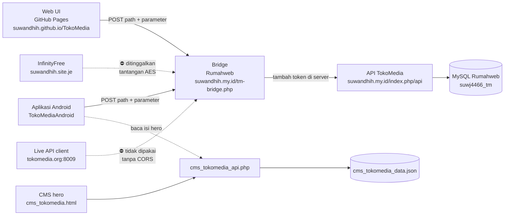
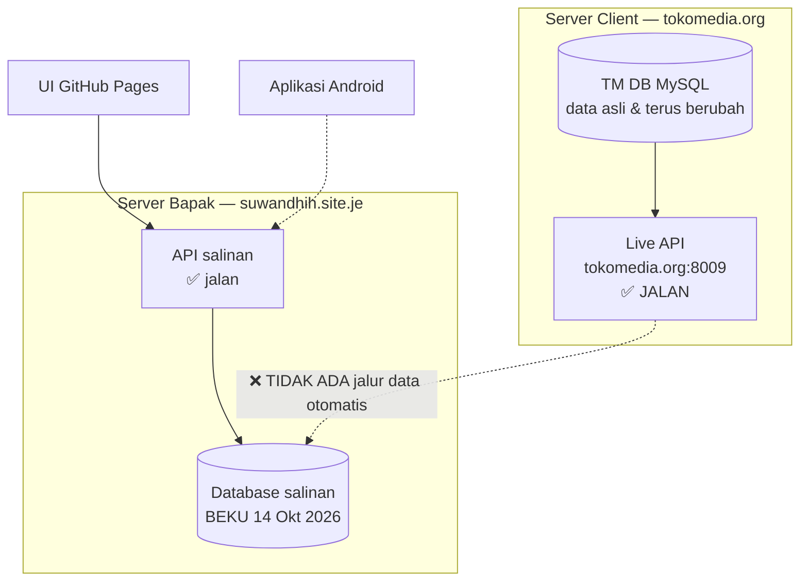

# 📋 RENCANA KERJA — TokoMedia

> **Berkas ini adalah catatan tunggal semua pekerjaan TokoMedia.**
> **Status Terkini (27 Okt 2026):** Aplikasi Android Native kini **responsif** di semua ukuran layar & skala font HP, dan **logo header memakai satu gambar utuh** (`ic_tm_brand.png`) sehingga proporsional di semua HP. Isi hero Pusat Media Nusantara dari CMS kini **langsung terbarui** di APK (refresh saat aplikasi kembali aktif + pull-to-refresh) dan di web `index.html` (refresh saat tab kembali aktif).

---

## 🚀 FOKUS UTAMA: BABAK BARU — PENGEMBANGAN ANDROID NATIVE

Target: Aplikasi Android (TokoMediaAndroid) terhubung ke API TokoMedia melalui bridge `https://suwandhih.my.id/tm-bridge.php` (token di server, tanpa hambatan CORS). **Tercapai** — lihat A1–A28.

| # | Tahap Pekerjaan Android | Status | Estimasi | Keterangan |
|---|---|---|---|---|
| **A1** | **Setup Network Client (Retrofit, OkHttp, Coil, Media3)** | ✅ SELESAI | 22 Okt 2026 | Retrofit 2.11, OkHttp 4.12, Gson, Coil 2.7, Media3 ExoPlayer HLS 1.5.1 |
| **A2** | **Konstruksi API Interface & Data Models (DTO)** | ✅ SELESAI | 22 Okt 2026 | `ApiModels.kt`, `TokoMediaApiService.kt`, `ApiClient.kt`, `TokoMediaRepository.kt` |
| **A3** | **Integrasi API ke Layar HomeScreen & VideoList** | ✅ SELESAI | 22 Okt 2026 | Tayangan terbaru dinamis + thumbnail Coil + VideoList terhubung ke endpoint API |
| **A4** | **Integrasi Pemutar Video HLS (ExoPlayer)** | ✅ SELESAI | 22 Okt 2026 | `VideoDetailScreen.kt` dengan Media3 PlayerView streaming playlist `.m3u8` |
| **A5** | **Build & Verifikasi APK Debug** | ✅ SELESAI | 22 Okt 2026 | Kompilasi sukses, berkas `TokoMedia-debug.apk` (24,8 MB) siap diuji |
| **A6** | **Penyelarasan UI Android ke Versi HP 430px (Spatial Bento)** | ✅ SELESAI | 22 Okt 2026 | Header Spatial Glass, Logo resmi + ribbon Mode HP, Hero Bento Card, Kategori Bento 01, dan Floating Bottom Dock |
| **A7** | **Penyempurnaan Proporsi Floating Dock & Hero Card** | ✅ SELESAI | 22 Okt 2026 | Tata letak dock vertikal (ikon atas, teks bawah 10.5sp, 4 kolom rapi sesuai index.html), hero bento lebih ringkas proporsional |
| **A8** | **Presisi UI Indeks A-Z & Streaming Terkini (100% Identik Screenshot)** | ✅ SELESAI | 22 Okt 2026 | Sesuai Screenshot Chrome HP: Toggle [Indeks A-Z] & [Galeri Ikon], badge huruf besar 'A' 8 Bahasa, filter rail alfabet A-Y, grid 2 kolom kartu bahasa dengan badge ungu + chevron hijau, urutan section 01, 02, 03 lengkap |
| **A9** | **Perbaikan Crash Parsing JSON 'Expected BEGIN_OBJECT but was BEGIN_ARRAY'** | ✅ SELESAI | 22 Okt 2026 | Tambahkan `VideoDetailDeserializer` pada Gson untuk menangani `data: []` saat API mengembalikan array kosong, sambungkan ke `tm-bridge.php` resmi |
| **A10** | **Implementasi Breadcrumb Navigasi Dinamis & Responsif** | ✅ SELESAI | 22 Okt 2026 | Breadcrumb TopBar dinamis mengikuti rute (`Beranda › Detail Video`, `Beranda › Film Isa Al-Masih › Daftar Bahasa`, dsb.) dengan pemisah chevron dan kotak sorot aktif persis index.html |
| **A11** | **Integrasi Formulir Tanggapan Anda & Tayangan Lainnya** | ✅ SELESAI | 22 Okt 2026 | Form Tanggapan Anda di VideoDetailScreen terhubung ke endpoint `other/commentvideo` Rumahweb (tersimpan di DB `videocomment`), dan daftar Tayangan Lainnya yang dapat diklik |
| **A12** | **Presisi Section Tayangan Pilihan Terbaru Beranda (4 Video Vertikal + Tombol CTA)** | ✅ SELESAI | 22 Okt 2026 | Tayangan Pilihan Terbaru dibatasi 4 video teratas, disusun secara vertikal 1 kolom penuh (.vcard), dan dilengkapi tombol pill 'Jelajahi Semua Koleksi per Wilayah →' persis index.html |
| **A13** | **Implementasi Layar Koleksi Aplikasi (Katalog Resmi Google Play 269 Apps)** | ✅ SELESAI | 22 Okt 2026 | Menu Aplikasi di bottom dock & kartu Aplikasi Kitab Suci diarahkan ke AppListScreen (pencarian filter bahasa, daftar 269 apps dengan logo + nama ✔ + tombol hijau [Unduh] ke Google Play Store persis Pasted Image 2) |
| **A14** | **Perbaikan Indikator Tab Aktif 'Aplikasi' di Bottom Dock** | ✅ SELESAI | 22 Okt 2026 | Pisahkan rute aplikasi menjadi rute unik `apps` agar tab 'Aplikasi' aktif berwarna hijau dan tidak salah menyorot tab 'Bahasa' |
| **A15** | **Implementasi Tombol Interaktif Suka / Favorite Video** | ✅ SELESAI | 22 Okt 2026 | Tombol 'Suka' berbingkai merah oval interaktif sesuai Pasted Image & index.html. Saat diklik seluruh tombol merespons, angka like bertambah langsung, berubah merah solid, dan terupdate ke endpoint `other/likevideo` Rumahweb |
| **A16** | **Sticky / Freeze Pemutar Video Saat Scroll Layar Detail** | ✅ SELESAI | 22 Okt 2026 | Pemutar video ExoPlayer 16:9 di-freeze tetap berada di atas layar. Area informasi, tombol Suka, form Tanggapan Anda, dan Tayangan Lainnya dapat di-scroll bebas di bawahnya tanpa memutus tayangan |
| **A17** | **Penyempurnaan Teks & Responsivitas 4 Kartu Bento Kategori Media** | ✅ SELESAI | 23 Okt 2026 | Judul kartu MiniBentoCard diatur 2 baris (`maxLines = 2`, `softWrap = true`, `fontSize = 13.sp`, `lineHeight = 16.5.sp`), subtitle `9.5.sp`, badge atas diringkas proporsional (`VIDEO SERI`, `SHORT CLIP`, `269 APPS`, `12 EPISODE`), tinggi kartu fleksibel `IntrinsicSize.Max` & `minHeight = 180.dp`. Build APK v0.1.1 (23,6 MB) bersih dan commit ke main. |
| **A18** | **Memperbaiki judul lengkap kartu Pilih Format Media agar responsif** | ✅ SELESAI | 23 Okt 2026 | Judul `Video Kitab Suci`, `Clip Kitab Suci`, `Aplikasi Kitab Suci`, dan `Film Ikatan Ilahi` dibuat memenuhi lebar kartu, maksimal 2 baris, tanpa ellipsis, dengan ukuran 14sp dan line height 17sp mengikuti contoh Pasted Image 2. Build APK debug berhasil. |
| **A19** | **Membuat CMS demo Pusat Media Nusantara tanpa login** | ✅ SELESAI | 23 Okt 2026 | Menambahkan `cms_tokomedia.html`, endpoint `cms_tokomedia_api.php`, dan data awal `cms_tokomedia_data.json`. CMS mengubah label, judul, deskripsi, serta dua teks tombol; penyimpanan menggunakan JSON di hosting. Sesuai permintaan demo, endpoint tidak memakai password. |
| **A20** | **Menghubungkan hero beranda APK ke CMS online** | ✅ SELESAI | 23 Okt 2026 | APK membaca `https://suwandhih.my.id/cms_tokomedia_api.php` saat beranda dibuka, dengan fallback teks bawaan jika endpoint gagal. Label, judul, deskripsi, dan dua teks tombol kini dapat diubah dari CMS. Endpoint teruji HTTP 200, build APK debug berhasil. |
| **A21** | **Memperbaiki pencarian, tab Tonton, dan fallback detail video** | ✅ SELESAI | 23 Okt 2026 | Tombol pencarian kini membuka `SearchScreen` dan memakai endpoint `search`. Tab Tonton serta tombol Tonton Tayangan Sorotan kini membuka daftar video Indonesia, bukan ID video tetap. Detail video gagal tidak lagi memutar video hardcoded; pengguna mendapat pesan jelas dan tombol Kembali. Build APK debug berhasil. |
| **A22** | **Mengaktifkan pencarian dan mode terang/gelap** | ✅ SELESAI | 23 Okt 2026 | Pencarian diperkuat dengan tombol dan tombol keyboard Search, hasil dapat dibuka ke detail, serta endpoint teruji mengembalikan 30 hasil. Ikon tema kini benar-benar mengganti Material light/dark color scheme melalui state aplikasi. Build APK debug berhasil. |
| **A23** | **Menyempurnakan background gelap dan hasil pencarian bahasa** | ✅ SELESAI | 23 Okt 2026 | Background home, pencarian, top bar, dan dock mengikuti color scheme gelap. Kartu hasil pencarian memakai surface aktif dan menampilkan kata kunci terformat di bawah judul, misalnya `Jawa`, sesuai contoh client. Endpoint `search` teruji HTTP 200 dengan 30 hasil; build APK debug berhasil. |
| **A24** | **Memperbaiki UI Android agar responsif di semua ukuran layar & skala font HP** | ✅ SELESAI | 27 Okt 2026 | Akar masalah: tata letak memakai tinggi/lebar tetap (`height(56.dp)`, `height(58.dp)`, `Row` tanpa `weight`) sehingga teks tumpang tindih saat skala font HP besar dan layar sempit. Perbaikan: (1) `MAX_FONT_SCALE = 1.3f` di `Theme.kt` + pembatasan `LocalDensity` di `MainActivity.kt`; (2) logo header dihitung dari lebar tersedia (`BoxWithConstraints`) dan tombol aksi mengecil di layar < 360dp; (3) dock bawah memakai `heightIn(min = 56.dp)` + label `maxLines = 1`; (4) kartu bento: badge & label jumlah bahasa memakai `weight` + ellipsis, ikon 30dp; (5) baris kanal/Suka di layar detail turun baris otomatis bila lebar < 330dp; (6) grid Indeks A–Z menjadi 1 kolom bila lebar < 340dp agar nama bahasa panjang tidak terpotong. Teruji di 320dp/360dp/430dp dengan font 1.0/1.3/2.0 — tidak ada tumpang tindih. Build APK debug (22,8 MB) bersih. |
| **A28** | **Logo header diganti satu gambar utuh (ikon + TOK▶MED‖A + tagline)** | ✅ SELESAI | 27 Okt 2026 | Akar masalah: logo disusun dari 7 potongan (gambar ikon + 3 `Text` + tombol play + 2 bar pause + `Text` tagline). Lebar `Text` ikut skala font HP sedangkan ikon/spasi tetap dp, sehingga rumus ukuran selalu menebak terlalu kecil dan logo tampak tidak proporsional. Solusi: seluruh logo digabung menjadi satu berkas gambar `res/drawable/ic_tm_brand.png` (1162×308, transparan) hasil komposisi `logo-preview.png`. Di `SpatialTopBar` blok 7 potongan diganti **satu** `Image` dengan tinggi dipatok (36dp; 30dp bila lebar < 360dp) dan lebar mengikuti rasio `BRAND_LOGO_ASPECT` (1162/308) di `Theme.kt`; ditambah batas `maxWidth / BRAND_LOGO_ASPECT` agar logo mengecil sendiri bila ruang sempit. Efek: proporsi selalu sama di semua ukuran layar, tidak terpengaruh pengaturan ukuran huruf HP, dan tidak ada lagi rumus yang bisa salah. Kode & import yang tidak terpakai (`CircleShape`, `PlayArrow`, `LocalDensity`, `sp`) dihapus. Teruji di 430dp/font 1.0 dan 320dp/font 2.0 — logo utuh, tajam, dan proporsional. Build APK debug (23,3 MB) bersih. Commit `d930fbe`. |
| **A27** | **Tagline MEDIA NUSANTARA disejajarkan di bawah wordmark** | ✅ SELESAI | 27 Okt 2026 | Sebelumnya tagline berada di bawah ikon toko sehingga terlihat terpisah dari tulisan `TOK▶MED‖A`. Tagline dipindah ke dalam `Column` yang sama dengan wordmark sehingga tepat sejajar di bawahnya, sesuai contoh client. Teruji di 430dp/font 1.0 dan 360dp/font 1.3. Build APK debug (23,3 MB) bersih. Commit `f45a4e3`. |
| **A26** | **Memperbaiki logo header yang tertimpa tombol aksi** | ✅ SELESAI | 27 Okt 2026 | Rumus ukuran logo di `SpatialTopBar` tidak memperhitungkan skala font HP, sehingga teks `TOK▶MED‖A` meluber dan huruf terakhir tertimpa tombol pencarian/tema (paling jelas saat tombol Back muncul). Rumus diganti menjadi `(lebarTersedia − 66dp) / (5.6 × fontScale)` dengan `fontScale` dari `LocalDensity`, ditambah `clipToBounds()` sebagai pengaman. Teruji di 320dp/360dp/430dp dengan font 1.0/1.3/2.0, dengan dan tanpa tombol Back — logo selalu utuh. Build APK debug (23,3 MB) bersih. Commit `bbd718c`. |
| **A25** | **Mengganti logo TM dengan logo resmi (toko hijau + pin merah)** | ✅ SELESAI | 27 Okt 2026 | Logo yang sebelumnya digambar manual (kotak hijau + karakter `⌂`) diganti dengan berkas logo resmi `Logo TM (Transparent).png` yang disalin ke `res/drawable/ic_tm_logo.png` (192×192). Dipakai di header (`SpatialTopBar`) dan avatar kanal di layar detail (`VideoDetailScreen`). Sekaligus dibuat ikon peluncur `res/mipmap-*/ic_launcher.png` (48–192 px, dipangkas ke area konten) dan didaftarkan di `AndroidManifest.xml` (`android:icon` & `android:roundIcon`). Teruji di 320dp/360dp/430dp dengan font 1.0/1.3/2.0 — logo tampil tajam dan tata letak tetap rapi. Build APK debug (23,3 MB) bersih. Commit `70af6ae`. |

| **A29** | **Memperbaiki keterlambatan perubahan isi CMS pada APK & menghubungkan hero web ke CMS** | ✅ SELESAI | 27 Okt 2026 | Akar masalah: (1) `LaunchedEffect(Unit)` hanya mengambil isi CMS **sekali** saat beranda pertama dibuka, sehingga APK yang sudah berjalan tidak pernah memperbarui teks; (2) tidak ada refresh saat aplikasi kembali aktif maupun pull-to-refresh; (3) kegagalan jaringan ditelan `onSuccess` sehingga tidak terlihat; (4) teks cadangan memakai `\\n` literal sehingga tampil `\n`; (5) `index.html` sama sekali tidak membaca CMS (teks hero masih hardcoded). Perbaikan Android: `LifecycleEventEffect(ON_RESUME)` + `PullToRefreshBox` di beranda, `cacheBuster` (`?_=<epoch>`) + header `Cache-Control: no-cache` pada `getCmsHomeContent`, pesan galat kecil di kartu hero, dan `\\n` → `\n` di `CmsHomeContentDto`. Perbaikan web: `loadCmsContent()` memanggil `cms_tokomedia_api.php` dengan cache-buster, `cmsValue`/`cmsHtml` mengisi label, judul, deskripsi, dan dua tombol hero, serta refresh otomatis saat tab kembali aktif (`visibilitychange`). Uji server: POST → GET langsung segar 8× berturut, tanpa header cache. Build APK debug bersih. |

---

## 📌 KEPUTUSAN STRATEGIS (20 OKT 2026)
1. **Web UI (index.html):** SELESAI & DIBEKUKAN. Berjalan stabil di GitHub Pages dengan data tertanam. Masalah CORS & tantangan anti-bot InfinityFree **resmi dihentikan/tidak dibahas lagi** untuk menghemat waktu.
2. **Koneksi Android:** API video tetap melalui bridge `https://suwandhih.my.id/tm-bridge.php`; Android native tidak memiliki aturan CORS.
3. **CMS hero:** `https://suwandhih.my.id/cms_tokomedia.html` menyimpan isi hero melalui `cms_tokomedia_api.php` dan `cms_tokomedia_data.json`. Konfigurasi tanpa login hanya untuk demo client.

---

## 🗄️ ARSIP CATATAN LAMA & RIWAYAT (DIBEKUKAN)

---

## 🗂️ Daftar Isi

| Bagian | Isi |
|---|---|
| [🚀](#-fokus-utama-babak-baru--pengembangan-android-native) | **FOKUS UTAMA: Pengembangan Android Native** |
| [A](#a-ringkasan-status) | Ringkasan Status |
| [B](#b-arsitektur-sistem) | Arsitektur Sistem |
| [C](#c-riwayat-pekerjaan-selesai) | Riwayat Pekerjaan Selesai |
| [D](#d-tahap-baru) | **TAHAP BARU** |
| [E](#e-pertanyaan-terbuka-untuk-client) | Pertanyaan Terbuka untuk Client |
| [F](#f-catatan-penting) | Catatan Penting |
| [G](#g-penempatan-api-client--sinkronisasi-data) | **Penempatan API Client & Sinkronisasi Data** |
| [H](#h-temuan-live-api-client-20-okt-2026) | **Temuan: Live API Client (20 Okt 2026)** |

---

## A. Ringkasan Status

| # | Pekerjaan | Status | Tanggal |
|---|---|---|---|
| 1 | Rilis awal UI TokoMedia (Spatial Bento Edition) | ✅ SELESAI | 18 Okt 2026 |
| 2 | Logo resmi tokomedia.org + tagline MEDIA NUSANTARA | ✅ SELESAI | 18 Okt 2026 |
| 3 | AGENTS.md — aturan kerja & anti-looping | ✅ SELESAI | 18 Okt 2026 |
| 4 | Mode HP 430px sebagai default | ✅ SELESAI | 19 Okt 2026 |
| 5 | API Prioritas 1 — perbaikan sebelum deploy | ✅ SELESAI | 19 Okt 2026 |
| 6 | API Prioritas 2 — endpoint baru, pagination, sorting | ✅ SELESAI | 19 Okt 2026 |
| 7 | API Prioritas 3 — kualitas, keamanan, dokumentasi | ✅ SELESAI | 19 Okt 2026 |
| 8 | Sambung `index.html` ke API TokoMedia | ✅ SELESAI | 19 Okt 2026 |
| 9 | Dukungan PHP 5.6 (agar bisa dipasang di tokomedia.org) | ✅ SELESAI | 19 Okt 2026 |
| 10 | Panduan deploy InfinityFree | ✅ SELESAI | 19 Okt 2026 |
| 11 | Paket permintaan ijin akses CORS untuk tim IT client | ✅ SELESAI | 20 Okt 2026 |
| 12 | Keluarkan token API dari repositori publik | ✅ SELESAI | 20 Okt 2026 |
| 13 | Bersihkan token + password SMTP dari seluruh riwayat Git | ✅ SELESAI | 20 Okt 2026 |
| 14 | Verifikasi API sudah terpasang & jalan di InfinityFree | ✅ SELESAI | 20 Okt 2026 |
| 15 | Diagnosa penyebab CORS gagal di InfinityFree | ✅ SELESAI | 20 Okt 2026 |
| 16 | Buat berkas `rencanakerja.md` ini | ✅ SELESAI | 20 Okt 2026 |
| 17 | ~~Perbaiki CORS di InfinityFree (unggah ulang `config.php`)~~ | ❌ **SALAH** — bukan itu sebabnya | 20 Okt 2026 |
| 18 | **Arahkan `apiBase` UI ke server InfinityFree** | ✅ SELESAI | 20 Okt 2026 |
| 19 | **Perbarui `DEPLOY.md` (langkah token & troubleshooting CORS)** | ✅ SELESAI | 20 Okt 2026 |
| 20 | **Putuskan status folder source code API client di repo publik** | ⬜ BELUM | — |
| 21 | **Rotasi token API (wajib — token lama masih bisa diakses)** | ⬜ BELUM | — |
| 22 | **Sambungkan aplikasi Android ke API** | ✅ SELESAI | 22 Okt 2026 |
| 23 | **Jawab pertanyaan penempatan API client (arsitektur sinkronisasi data)** | ✅ SELESAI | 20 Okt 2026 |
| 24 | **Buat panduan `PERBAIKAN-CORS-INFINITYFREE.md`** | ⚠️ SALAH — sudah dihapus, diganti `TEMUAN-TANTANGAN-AES-INFINITYFREE.md` | 20 Okt 2026 |
| 25 | **Temukan Live API client di `tokomedia.org:8009` (sebelumnya disangka belum dipasang)** | ✅ SELESAI | 20 Okt 2026 |
| 26 | **AKAR MASALAH TERBUKTI — tantangan JavaScript AES InfinityFree (bukan CORS)** | ✅ SELESAI | 20 Okt 2026 |
| 27 | **Ganti host API — tinggalkan InfinityFree** | 🟡 MENUNGGU KEPUTUSAN | — |
| 28 | **Tantangan AES terbukti bisa dilewati bila UI satu origin dengan API** | ✅ TERBUKTI | 20 Okt 2026 |
| 29 | **Cloudflare terbukti tidak mungkin untuk `suwandhih.site.je`** | ✅ TERBUKTI | 20 Okt 2026 |
| 26 | **Petakan endpoint Live API client vs salinan sendiri** | ✅ SELESAI | 20 Okt 2026 |
| 27 | **Catat jawaban IT client: self-host adalah jalur yang dimaksudkan** | ✅ SELESAI | 20 Okt 2026 |
| 30 | **Pasang API salinan di Rumahweb `suwandhih.my.id`** | ✅ SELESAI | 21 Okt 2026 |
| 31 | **Arahkan UI GitHub Pages ke API Rumahweb** | ✅ SELESAI | 21 Okt 2026 |
| 32 | **Uji endpoint dengan token asli** | ✅ SELESAI — `status=200`, 7 kategori | 21 Okt 2026 |
| 33 | **Hapus akun FTP sementara `tmup2`** | ⬜ BELUM | — |
| 34 | **Perbaiki UI Android agar responsif di semua ukuran layar & skala font HP** | ✅ SELESAI | 27 Okt 2026 |
| 35 | **Ganti logo TM dengan logo resmi + ikon peluncur** | ✅ SELESAI | 27 Okt 2026 |
| 36 | **Logo header jadi satu gambar utuh (proporsional di semua HP)** | ✅ SELESAI | 27 Okt 2026 |
| 37 | **Perbarui dokumentasi `AGENTS.md`, `prompt.md`, `rencanakerja.md`** | ✅ SELESAI | 27 Okt 2026 |

---

## B. Arsitektur Sistem



> **Catatan (27 Okt 2026):** jalur produksi adalah **GitHub Pages / Android → bridge Rumahweb → API Rumahweb → MySQL**. Token hanya ada di server bridge, sehingga pengunjung tidak pernah diminta token.
>
> **Sejarah (20 Okt 2026):** InfinityFree ditinggalkan karena memasang tantangan JavaScript AES di depan seluruh akun (lihat **C23**), dan Live API client `tokomedia.org:8009` tidak dipakai karena tanpa CORS serta tidak punya endpoint `category/tree` + `aplikasi/list` (lihat **H**).

| Bagian | Tempat | Status |
|---|---|---|
| Tampilan (`index.html`) | GitHub Pages | ✅ Jalan (dibekukan) |
| Bridge API | Rumahweb `suwandhih.my.id/tm-bridge.php` | ✅ **Aktif** — dipakai Web UI & Android |
| API (PHP CodeIgniter 3) | Rumahweb `suwandhih.my.id/index.php/api` | ✅ Jalan, token di server |
| Database | MySQL Rumahweb `suwj4466_tm` | ✅ Terisi |
| CMS hero | Rumahweb `cms_tokomedia.html` + `cms_tokomedia_api.php` | ✅ Jalan (demo tanpa login) |
| Aplikasi Android | `TokoMediaAndroid` (APK debug) | ✅ Terhubung bridge, UI responsif, logo 1 gambar |
| Live API client | `tokomedia.org:8009` | ⛔ Tidak dipakai (tanpa CORS, endpoint tidak lengkap) |
| API salinan lama | InfinityFree `suwandhih.site.je` | ⛔ Ditinggalkan (tantangan AES) |

**Bridge aktif:** `https://suwandhih.my.id/tm-bridge.php` — token diinjeksi di server, pengunjung tidak pernah melihat token.
**Live API client (arsip):** `https://tokomedia.org:8009/index.php/api/` — Apache/2.2.15 (CentOS), PHP 5.6.29, CodeIgniter 3.1.13.

---

## C. Riwayat Pekerjaan Selesai

### C1. Rilis awal UI TokoMedia — ✅ SELESAI (18 Okt 2026)

- Commit `21975b1` — Rilis awal TokoMedia Spatial Bento Edition dan repositori lengkap.
- Berkas `index.html` tunggal, mandiri, tanpa dependensi luar.
- Dipasang di GitHub Pages: <https://suwandhih.github.io/TokoMedia/>

### C2. Logo resmi + tagline — ✅ SELESAI (18 Okt 2026)

- Commit `0dc2d21` — Samakan logo dengan versi resmi tokomedia.org (ikon toko, play, pause, teks utuh).
- Commit `5c74884` — Tagline menjadi **MEDIA NUSANTARA**.
- Commit `c84837c` — Judul halaman & preview OpenGraph: `TOKO MEDIA - Media Nusantara`.
- Commit `24364b6` — Hapus 4 kotak summary statistik di beranda.

### C3. AGENTS.md — ✅ SELESAI (18 Okt 2026)

- Commit `4c1e9ac` — Aturan kerja, anti-looping, estimasi waktu, standar TokoMedia.
- Commit `b1fadbf` (19 Okt) — Tambah aturan **A7: wajib selalu push ke GitHub**.

### C4. Mode HP 430px default — ✅ SELESAI (19 Okt 2026)

- Commit `c915111` — Mode HP 430px jadi default, layar penuh sebagai opsi kedua.
- Commit `31fdc61` — Sederhanakan label dock bawah: Beranda, Bahasa, Tonton, Aplikasi.

### C5. API Prioritas 1 — ✅ SELESAI (19 Okt 2026)

- Commit `7df5384` — Perbaikan sebelum deploy.
- Migrasi `database/20261019_priority3.sql`: tabel `videolike`, `user_login.password` → varchar(255), kolom `password_algo`.
- Library `Password_hash.php`: verifikasi SHA-1 lama, otomatis naik ke argon2id/bcrypt.

### C6. API Prioritas 2 — ✅ SELESAI (19 Okt 2026)

- Commit `aef77bc` — Endpoint baru + pagination + sorting.
- Pagination: `page` (mulai 1), `per_page` (maks 100, default 20); `limit`/`offset` lama tetap didukung.
- Sorting: `trending`, `popular`, `newest`, `oldest`, `unseen`, `default`.

### C7. API Prioritas 3 — ✅ SELESAI (19 Okt 2026)

- Commit `be68ffc` — Kualitas, keamanan, dokumentasi.
- Rate limit `api_rate_limit($bucket, $max=30, $window=60)` berbasis berkas di `application/cache/`.
- `api_client_id()`: POST `device_id` (disaring `[A-Za-z0-9_-]`, maks 64), jika tidak ada → `sha1(IP|User-Agent)`.

### C8. Sambung UI ke API — ✅ SELESAI (19 Okt 2026)

- Commit `482c348` — `index.html` memanggil API TokoMedia.
- Envelope balasan: `{status, message, data}` — `status` adalah kode **internal** (200 sukses / 201 validasi / 404 gagal); **HTTP status selalu 200**.
- Jika `TM_API_TOKEN` kosong → semua endpoint menolak `{status:404, message:"No Permission"}`.

### C9. Dukungan PHP 5.6 — ✅ SELESAI (19 Okt 2026)

- Commit `51b555b` — Agar bisa dipasang di hosting `tokomedia.org`.
- Diuji pada PHP 5.6.40 / 8.3.35 / 8.4.26 — 25/25 endpoint balas status 200.

### C10. Panduan deploy InfinityFree — ✅ SELESAI (19 Okt 2026)

- Commit `7c14130` — `20261014 API TM App/DEPLOY.md` + abaikan dump `.sql.gz`.
- Commit `7e5a430` — Siapkan deploy ke hosting PHP 8.3 + MySQL 8.
- Dump MySQL 8: `deploy-tokomedia-mysql8.sql` (26 MB, 34.996 INSERT, 15 tabel).
- ⚠️ Dump asli `20261014-tokomedia DB Structure and Data.sql` **jangan dipakai** — MySQL 8 menolak tanggal `0000-00-00`.

### C11. Paket permintaan ijin akses CORS — ✅ SELESAI (20 Okt 2026)

- Commit `60d1804` — Berkas `PERMINTAAN-IJIN-AKSES-API.md`.
- Isi: ringkasan masalah + hasil uji, kalimat permintaan, 4 varian script (PHP / Apache `.htaccess` / Nginx / pengikatan Origin), perintah verifikasi `curl`, catatan teknis.
- Hasil uji server client: `POST https://www.tokomedia.org/api/index.php/api/category/tree` → HTTP 200 tapi `Content-Type: text/html` (halaman login website, bukan JSON). **API belum dipasang di server client.**

### C12. Keluarkan token API dari repositori — ✅ SELESAI (20 Okt 2026)

- Commit `fb3e9a6` — Token dihapus dari `index.html`.
- Token lama: `AMRmryxy…M90J` (64 karakter) — **sudah tidak ada di berkas repo**.
- Pola baru:
  - `index.html` membaca `window.TM_CONFIG.token` (bukan token tertulis).
  - `config.local.js` — menyimpan token, **diabaikan Git** (`.gitignore`).
  - `config.example.js` — contoh/templat, ikut Git.
  - `loadLocalConfig()` memuat `config.local.js` sebelum `loadBootstrapData()`.
  - `apiPost()` menolak jalan jika token belum diisi.
- `DOKUMENTASI-API-TM-App.md` — ditambah bagian **"🚫 Jangan pernah tulis token di berkas yang ikut Git"**.

### C13. Bersihkan riwayat Git — ✅ SELESAI (20 Okt 2026)

- Alat: `git-filter-repo` 2.47.0.
- Dibersihkan: token API (ada di 9 commit) + password SMTP `info@tokomedia.org` (ada di 6 commit).
- Riwayat: 84 commit → **18 commit**. Force-push ke `main` berhasil.
- Verifikasi: pencarian kode GitHub = 0 hasil; situs live bersih; build Pages sukses.
- ⚠️ **Temuan penting:** GitHub **masih menyajikan objek commit lama lewat SHA langsung** (mis. `raw.githubusercontent.com/suwandhih/TokoMedia/1e031bf/index.html` → HTTP 200 berisi token utuh), walau commit itu sudah tidak terjangkau lewat ref/PR/fork. **Karena itu rotasi token wajib.**
- Cadangan riwayat lama: `C:\data\TokoMedia-backup-before-purge.bundle` (5.876.413 byte).

### C14. Verifikasi API di InfinityFree — ✅ SELESAI (20 Okt 2026)

- `POST http://suwandhih.site.je/index.php/api/category/tree` + token → `{"status":200,"message":"Success","data":[...]}` sebesar **68.819 byte** JSON asli, `Content-Type: application/json`.
- Tanpa token → `{"status":404,"message":"Parameter is needed","data":[]}`.
- HTTPS: `https://suwandhih.site.je/` → HTTP 200, sertifikat valid.
- **Kesimpulan: API sudah terpasang dan berfungsi.**

### C15. Diagnosa penyebab CORS gagal — ✅ SELESAI (20 Okt 2026)

**Gejala** — diuji dari `https://suwandhih.github.io/TokoMedia/`:

```
Access to fetch at 'https://suwandhih.site.je/index.php/api/category/tree'
from origin 'https://suwandhih.github.io' has been blocked by CORS policy:
No 'Access-Control-Allow-Origin' header is present on the requested resource.
```

**Hasil pemeriksaan:**

| Yang diperiksa | Hasil |
|---|---|
| Hook `Api_cors.php` jalan di server | ✅ Ya — header `Access-Control-Allow-Methods`, `Allow-Headers`, `Max-Age` muncul |
| Header `Access-Control-Allow-Origin` | ❌ **Tidak ada**, untuk semua origin yang diuji |
| `$config['cors_origins']` di server | ❌ Kosong / tidak ada |
| Zip `Backup/tokomedia-api-infinityfree.zip` | ✅ Sudah berisi CORS + `cors_origins` |
| Zip asli client `Backup/20261014 API TM App.zip` | ❌ Tidak ada CORS sama sekali |

**Akar masalah:** berkas `application/config/config.php` yang ada di server InfinityFree adalah **versi lama** (belum punya `$config['cors_origins']`), sedangkan `hooks.php` + `Api_cors.php` sudah **versi baru**. Hook jalan, tapi daftar origin kosong → tidak pernah cocok → header ACAO tidak pernah dikirim.

**Catatan penting:** ini server milik Bapak sendiri, jadi **tidak perlu minta tim IT client**. Cukup unggah ulang `config.php` dari zip ke `htdocs` lewat File Manager InfinityFree.

### C16. Buat `rencanakerja.md` — ✅ SELESAI (20 Okt 2026)

- Berkas ini dibuat sebagai catatan tunggal semua pekerjaan TokoMedia.

### C17. Jawab pertanyaan penempatan API client — ✅ SELESAI (20 Okt 2026)

- Bapak bertanya: *"apakah API milik client lebih tepat ditempatkan dimana? supaya jika dia update data baru.. server saya juga terupdate"*
- **Jawaban:** menyalin API client **tidak** membuat data ter-update otomatis. Yang diterima adalah kode statis + snapshot database beku (14 Okt 2026). Tidak ada jalur data dari server client ke server Bapak.
- **Rekomendasi:** **Hibrida** — pakai server sendiri sekarang (sudah jalan, tidak bergantung pihak lain), dan berpindah ke API live client nanti bila mereka memasangnya. Berpindah hanya perlu ubah **1 baris** `apiBase`.
- Jawaban lengkap + diagram + kalimat siap kirim ke client → bagian **G** berkas ini.

### C18. Perbaikan CORS di InfinityFree (D1) — ❌ DIKOREKSI (20 Okt 2026) → lihat C23 & D7

- Awalnya disimpulkan akar masalahnya: `config.php` di hosting masih versi lama.
- Dibuat panduan langkah-demi-langkah: **`PERBAIKAN-CORS-INFINITYFREE.md`** (sudah dihapus).
- ⚠️ **Ternyata diagnosa ini SALAH** — ketiga berkas di hosting sudah versi baru; penyebab sebenarnya adalah tantangan JavaScript AES InfinityFree. Rincian: **C23**. Berkas `PERBAIKAN-CORS-INFINITYFREE.md` **sudah dihapus** dan diganti **`TEMUAN-TANTANGAN-AES-INFINITYFREE.md`**.
- Rencana penanganan baru: **D7**.

### C19. Arahkan `apiBase` UI ke server InfinityFree (D2) — ✅ SELESAI (20 Okt 2026)

- `index.html` baris 1626: `https://www.tokomedia.org/api/index.php/api` → `https://suwandhih.site.je/index.php/api`.
- **Uji sintaks:** `node --check` pada skrip utama `index.html` → **valid**.
- **Uji live (aturan B5):**

| Mode | Lebar | Header | Overflow horizontal |
|---|---|---|---|
| Layar Penuh | 1440 px | ✅ Utuh, nav horizontal tampil | 0 px |
| Layar Penuh | 1024 px | ✅ Utuh | 0 px |
| Mode HP 430px | 430 px | ✅ Utuh, tidak terpotong | 0 px |
| HP kecil | 360 px | ✅ Utuh | 10 px (bawaan desain, bukan akibat revisi) |

- **Bukti D2 sudah live:** Console browser di <https://suwandhih.github.io/TokoMedia/> menampilkan error CORS yang menyebut `https://suwandhih.site.je/index.php/api/category/tree` — artinya UI **sudah** memanggil server InfinityFree, bukan lagi `tokomedia.org`.
- **UI tetap tampil normal** walau API belum bisa dipanggil — semua panggilan API punya `.catch()` yang jatuh ke data tertanam (`window.TM_PAYLOAD`). Tidak ada halaman kosong.
- Error CORS tersebut ternyata **bukan** karena konfigurasi API (lihat **C23**) — penyebabnya tantangan JavaScript AES InfinityFree. Penanganannya pindah ke **D7**.

### C20. Perbarui `DEPLOY.md` (D3) — ✅ SELESAI (20 Okt 2026)

- Bagian 6 "Uji" ditulis ulang → pakai Console browser, bukan `curl`.
- Bagian 7 "Hubungkan UI" ditulis ulang → pakai `config.local.js`, bukan token di `index.html`.
- Bagian 8 "Troubleshooting CORS" ditambah (baru) — ⚠️ **isinya perlu ditulis ulang** karena berdasar diagnosa yang salah (lihat **C23**).
- Tabel "Catatan teknis" ditambah 4 baris.

### C21. Temukan Live API client di `tokomedia.org:8009` — ✅ SELESAI (20 Okt 2026)

**Latar:** IT client mengirim gambar yang menjelaskan ada 2 mode: **Live mode** (TM App → Live API → TM DB MySQL) dan **Developer mode** (TM web mobile → TM API copy → TM_DB copy). Dari gambar itu terlihat Live API berada di `tokomedia.org:8009`.

**Kesimpulan lama yang SALAH:** sebelumnya disimpulkan "API client belum dipasang di `tokomedia.org`" — itu keliru, karena yang diuji waktu itu adalah `https://www.tokomedia.org/api/index.php/api` (jalur salah, mengembalikan halaman login HTML). Jalur yang benar memakai **port 8009**.

**Hasil uji langsung:**

| Uji | Hasil |
|---|---|
| TCP port 8009 | ✅ terbuka |
| `GET https://tokomedia.org:8009/index.php` | HTTP 200 — halaman selamat datang CodeIgniter 3.1.13 |
| Server | Apache/2.2.15 (CentOS), PHP/5.6.29 |
| `POST .../index.php/api/vkitab` + token | ✅ `{"status":200,"message":"Success",...}` |
| `POST .../index.php/api/other/latestvideo` | ✅ data video nyata |
| `POST .../index.php/api/category/tree` | ❌ 404 — tidak ada di Live API |
| `POST .../index.php/api/aplikasi/list` | ❌ 404 — tidak ada di Live API |
| Header CORS | ❌ **tidak ada `Access-Control-Allow-Origin` sama sekali** |
| Token yang sama | ✅ berfungsi di Live API **dan** di salinan sendiri |

**Peta endpoint Live API vs salinan sendiri:**

| Endpoint | Live API | Salinan sendiri | Dipakai UI? |
|---|---|---|---|
| `vkitab`, `vkitab/detail`, `vkitab/language` | ✅ | ✅ | ✅ |
| `ckitab`, `ckitab/detail` | ✅ | ✅ | ✅ |
| `riwayat`, `riwayat/detail` | ✅ | ✅ | ✅ |
| `ikatan`, `other`, `other/latestvideo`, `contact` | ✅ | ✅ | ✅ |
| `aplikasi`, `aplikasi/detail` | ✅ | ✅ | ✅ |
| **`category/tree`** | ❌ 404 | ✅ | ✅ **YA** |
| **`aplikasi/list`** | ❌ 404 | ✅ | ✅ **YA** |
| `audio`, `media`, `search`, `other/slideshow`, `other/config`, `contact/send`, `ikatan/detail` | ❌ 404 | ✅ | — |

**Akibat penting:** UI memanggil 3 endpoint saat mulai — `category/tree` (❌ tidak ada di Live), `other/latestvideo` (✅ ada), `aplikasi/list` (❌ tidak ada di Live). Jadi **UI tidak bisa jalan penuh di Live API** walaupun CORS diperbaiki. Ini memperkuat keputusan Bapak untuk tetap memakai server sendiri.

**Catatan:** endpoint yang 404 di Live API itu **persis endpoint yang dibuat pada pekerjaan "API Prioritas 2" (19 Okt 2026)** — hanya ada di salinan Bapak dan belum pernah dikirim ke client.

**Tindak lanjut:** seluruh temuan dicatat di bagian **H**; keputusan Bapak dicatat di **H5**; pertanyaan untuk IT client di **H7**.

### C22. Catat jawaban IT client — self-host adalah jalur yang dimaksudkan — ✅ SELESAI (20 Okt 2026)

**Pesan IT client (20 Okt 2026):**

> ini source code API dan database TM. jadi ini bisa diinstal sendiri, boleh di hosting atau localhost (laptop sendiri)
> Jadi bisa simulasi sendiri API call nya.
> jadi tidak perlu pakai live API yg ada batasan CORS.

**Pembacaan Bapak:** *"IT client tidak berharap sistem baru live."* — **tepat.**

**Yang terjawab:**

| Pertanyaan | Jawaban |
|---|---|
| Apakah Live API ditawarkan untuk aplikasi Bapak? | ❌ **Tidak** — client justru bilang "tidak perlu pakai live API" |
| Apakah perlu minta CORS ke IT? | ❌ **Tidak perlu** |
| Apakah perlu minta endpoint baru ke IT? | ❌ **Tidak perlu** |
| Apakah self-host diizinkan? | ✅ **Ya** — "boleh di hosting atau localhost (laptop sendiri)" |

**Kesimpulan:** self-host **bukan sekadar pilihan yang lebih aman — itu jalur yang memang dimaksudkan client.** Karena itu berkas `PERMINTAAN-IJIN-AKSES-API.md` **tidak diperlukan lagi**.

**Strategi Bapak (dicatat di H7b):** jalan dulu dengan server sendiri sampai **client puas**, baru **minta Live API**. Revisinya kecil — cukup ganti 1 baris `apiBase` di `index.html` dan 1 nilai `BASE_URL` di Android.

**Yang masih terbuka:** hanya **E1 — pembaruan data** (apakah client akan mengirim dump baru berkala).

### C23. AKAR MASALAH CORS TERBUKTI — tantangan JavaScript AES InfinityFree — ✅ SELESAI (20 Okt 2026)

**Diagnosa lama (SALAH):** "`config.php` di hosting masih versi lama sehingga daftar `cors_origins` kosong."

**Diagnosa benar:** penyebabnya **bukan** konfigurasi. Ketiga berkas di hosting sudah versi baru. Yang menghalangi adalah **tantangan JavaScript AES** yang dipasang InfinityFree di depan seluruh akun.

**Bukti 1 — berkas di hosting sudah benar.** Daftar isi `/htdocs/application/config/` dan `/htdocs/application/hooks/` diperiksa lewat File Manager InfinityFree:

| Berkas | Ukuran di hosting | Status |
|---|---|---|
| `application/config/config.php` | 19,33 KB | ✅ versi baru (ada `cors_origins`) |
| `application/config/hooks.php` | 772 B | ✅ versi baru (ada hook CORS) |
| `application/hooks/Api_cors.php` | 1,31 KB | ✅ ada |

**Bukti 2 — respons pertama adalah halaman tantangan, bukan JSON.** Permintaan `POST https://suwandhih.site.je/index.php/api/category/tree` (dengan User-Agent browser + header `Origin`) membalas:

| Yang diperiksa | Hasil |
|---|---|
| Status | `200 OK` (menipu — bukan dari API) |
| `Content-Type` | `text/html` ← **bukan** `application/json` |
| `Content-Length` | `871` |
| `Server` | `openresty` |

Isi 871 byte itu:

```html
<script type="text/javascript" src="/aes.js"></script>
<script>... a=toNumbers("f655ba9d..."),b=toNumbers("98344c2e..."),c=toNumbers("c77994d5...");
document.cookie="__test="+toHex(slowAES.decrypt(c,2,a,b))+"; ...;
location.href="https://suwandhih.site.je/index.php/api/category/tree?i=1";</script>
```

**Bukti 3 — kalau tantangan diselesaikan, API menjawab SEMPURNA.** Tantangan itu adalah AES-128-CBC (`slowAES.decrypt(c,2,a,b)` = mode CBC, padding nol). Setelah nilai `__test` dihitung dan dikirim sebagai cookie:

| Header balasan | Nilai |
|---|---|
| `Content-Type` | `application/json` ✅ |
| `Access-Control-Allow-Origin` | `https://suwandhih.github.io` ✅ |
| `Access-Control-Allow-Methods` | `POST, GET, OPTIONS` ✅ |
| `Access-Control-Allow-Headers` | `Content-Type, X-Requested-With` ✅ |
| `Access-Control-Max-Age` | `86400` ✅ |
| `Vary` | `Accept-Encoding, Origin` ✅ |
| Panjang isi | 68.819 byte JSON asli ✅ |

**Kesimpulan:** `config.php`, `hooks.php`, dan `Api_cors.php` **sudah 100% benar**. CORS gagal **murni** karena browser menembak halaman tantangan.

**Kenapa browser gagal padahal cookie bisa dibuat?** Karena `__test` harus ada pada **permintaan pertama**. Untuk mendapatkannya, browser harus menjalankan `/aes.js` dari halaman HTML — dan itu tidak mungkin dilakukan lintas-origin dari GitHub Pages. Percobaan `credentials: 'include'` tetap gagal: permintaan pertama tidak membawa cookie, dan `Access-Control-Allow-Credentials` memang tidak dikirim (memang tidak diperlukan).

**Tantangan ini berlaku di seluruh akun** — diuji pada HTTP, HTTPS, `?i=1`, bahkan halaman statis `/`:

| Yang diuji | `Content-Type` | Panjang | ACAO |
|---|---|---|---|
| `http://suwandhih.site.je/.../category/tree` | `text/html` | 870 | tidak |
| `https://suwandhih.site.je/.../category/tree` | `text/html` | 871 | tidak |
| `https://suwandhih.site.je/.../category/tree?i=1` | `text/html` | 871 | tidak |
| `https://suwandhih.site.je/` (statis) | `text/html` | 844 | tidak |
| `https://suwandhih.site.je/DEPLOY.md` (statis) | `text/html` | 853 | tidak |

**Server client bersih.** `tokomedia.org` dan `www.tokomedia.org` ada di `103.23.201.26` (Apache/2.2.15 CentOS) — **bukan** InfinityFree. Jadi tantangan ini hanya menimpa host uji `suwandhih.site.je`.

**Konsekuensi:** **InfinityFree tidak bisa dipakai sebagai host API.** Tidak ada pengaturan di panel InfinityFree untuk mematikan tantangan ini — ini memang mekanisme anti-bot mereka. Solusinya ada di **D7**.

### C24. Tantangan AES ternyata BISA DILEWATI — syaratnya UI sekamar dengan API — ✅ TERBUKTI (20 Okt 2026)

**Temuan:** tantangan AES hanya menghalangi permintaan **lintas-origin**. Bila halaman UI berada di **origin yang sama** dengan API, browser sudah menyelesaikan tantangan saat memuat halaman, sehingga permintaan API lolos.

**Bukti 1 — dari origin yang sama, API menjawab sempurna.** Console dibuka **di halaman InfinityFree itu sendiri** (`https://suwandhih.site.je/`), lalu API dipanggil dengan jalur relatif:

| Yang diperiksa | Hasil |
|---|---|
| `origin` | `https://suwandhih.site.je` |
| Cookie `__test` ada? | ✅ **ya** (dibuat browser saat halaman dimuat) |
| `Content-Type` | `application/json` ✅ |
| Panjang isi | **68.819 byte** — data asli ✅ |
| `Access-Control-Allow-Origin` | `null` — **tidak perlu**, memang same-origin ✅ |

**Bukti 2 — cookie tetap bertahan setelah cookie dibersihkan.** Setelah `clearCookies()` lalu halaman dimuat ulang, cookie `__test` **muncul kembali** dan API tetap membalas `application/json` 68.819 byte. Jadi browser **selalu** bisa melewatinya selama halaman dibuka langsung dari origin itu.

**Bukti 3 — berkas statis juga bisa dilewatkan.** Diperiksa dari origin yang sama:

| Jalur | Status | `Content-Type` | Panjang | Arti |
|---|---|---|---|---|
| `/aes.js` | `200` | `application/javascript` | 13.733 | berkas tantangan disajikan normal |
| `/index.html` | `404` | `text/plain` | 220 | `index.html` **belum ada** di `htdocs/` |
| `/application/hooks/index.html` | `403` | `text/plain` | 241 | diblokir `.htaccess` (memang benar) |
| `/nope-xyz.html` | `404` | `text/plain` | 220 | jujur 404 — **bukan** tantangan |

Rentetan ini membuktikan permintaan dari origin yang sama **sungguh sampai ke server** (bukan tantangan), karena 404 dan 403 asli bisa dibedakan.

**Akibat — jalur baru: taruh UI di InfinityFree bersama API.** Bila `index.html` UI ditaruh di `htdocs/index.html` (atau `htdocs/ui/index.html`), maka:

- UI dan API **satu origin** → CORS tidak berlaku sama sekali.
- Tantangan AES **sudah** dilewati browser saat halaman dimuat.
- Token API **tidak perlu** dikirim lewat berkas publik, karena bisa dibaca dari `secrets.php` server.
- GitHub Pages tetap dipertahankan sebagai **pratinjau**, bukan sumber data.

**Kendala:** berkas UI saat ini **208.515 byte** (208 KB, satu berkas mandiri). InfinityFree biasanya membatasi ukuran berkas, jadi perlu diuji. Cara unggah: File Manager → **Upload** (halaman **tidak** kena tantangan, yang kena hanya permintaan `fetch`).

**Catatan tambahan — token di UI live GitHub Pages saat ini KOSONG.** Diperiksa 20 Okt 2026:

| Yang diperiksa | Hasil |
|---|---|
| `apiBase` di `index.html` live | `https://suwandhih.site.je/index.php/api` ✅ |
| `config.local.js` di GitHub Pages | **404** — tidak ada |
| Token literal di `index.html` | tidak ada ✅ (memang benar, jangan ditulis) |

Artinya UI live **belum punya token**, sehingga `apiPost()` langsung menolak dengan pesan *"Token API belum dikonfigurasi"* — API tidak pernah dipanggil. Jadi ada **2 hal** yang harus beres, bukan 1: (a) origin/CORS, dan (b) token. Bila UI dipindah ke InfinityFree, token bisa ditaruh di `config.local.js` **di server itu** (tidak masuk Git) — satu origin, langsung jalan.

**Saran penempatan:** taruh di `htdocs/ui/index.html` → alamat `https://suwandhih.site.je/ui/`. Ini menghindari benturan dengan `index.php` (CodeIgniter) yang sudah memakai `/`.

### C25. Cloudflare TIDAK BISA dipakai untuk `suwandhih.site.je` — ✅ TERBUKTI (20 Okt 2026)

**Kesimpulan:** pilihan "pasang Cloudflare" di **D7 nomor 1** **tidak mungkin dijalankan** dan sudah dicoret.

**Alasannya:** `site.je` adalah **subdomain gratis** dari InfinityFree. Nameserver domain induknya milik InfinityFree:

| Domain | Nameserver |
|---|---|
| `site.je` | `ns1.byet.org`, `ns2.byet.org`, `ns3.byet.org`, `ns1.site.je` |

Cloudflare mengendalikan **seluruh zone** — untuk mengaktifkannya, **nameserver domain induk harus diganti** ke nameserver Cloudflare. Karena `site.je` bukan milik Bapak dan NS-nya tidak bisa diubah dari panel InfinityFree, Cloudflare tidak bisa dipasang.

**Syarat bila tetap ingin Cloudflare:** harus punya **domain sendiri** (mis. `tokomedia.id`) dengan akses nameserver penuh, lalu diarahkan ke InfinityFree. Itu berarti biaya tambahan.

**Catatan:** Cloudflare juga **tidak akan menolong** — tantangan AES dipasang InfinityFree **sesudah** Cloudflare, jadi permintaan tetap kena tantangan.

---

## D. TAHAP BARU

> Bagian ini untuk pekerjaan yang **belum dikerjakan**. Setiap tahap baru langsung dicatat di sini.

### D1. Perbaiki CORS di InfinityFree — ❌ DIKOREKSI (20 Okt 2026) → pindah ke D7

> **PENTING — diagnosa awal SALAH.** Awalnya disimpulkan `config.php` di hosting masih versi lama. Setelah memeriksa langsung isi hosting, **ternyata ketiga berkas sudah versi baru**. Penyebab sebenarnya adalah **tantangan JavaScript AES milik InfinityFree**. Rincian: lihat **C23** dan **D7**.

**Diagnosa awal (keliru):**

| Berkas | Zip client asli (14 Okt) | Zip infinityfree (19 Okt) | **Terpasang di hosting** |
|---|---|---|---|
| `application/config/config.php` | 19.257 B — tanpa `cors_origins` | 19.797 B — ada `cors_origins` | ✅ **19,33 KB — versi baru** |
| `application/config/hooks.php` | 430 B — tanpa hook CORS | 772 B — ada hook CORS | ✅ **772 B — versi baru** |
| `application/hooks/Api_cors.php` | tidak ada | ada (1.341 B) | ✅ **1,31 KB — ada** |

**Kesimpulan:** tidak ada yang perlu diperbaiki pada konfigurasi. Berkas `PERBAIKAN-CORS-INFINITYFREE.md` **sudah dihapus** dan diganti **`TEMUAN-TANTANGAN-AES-INFINITYFREE.md`**.

---

### D2. Arahkan `apiBase` UI ke server InfinityFree — ✅ SELESAI (20 Okt 2026)

**Tujuan:** UI memanggil server yang benar-benar hidup.

**Masalah:** di `index.html`, `apiBase` masih menunjuk `https://www.tokomedia.org/api/index.php/api` — server itu **belum memasang API** (balas halaman login HTML, bukan JSON).

**Hasil:** `index.html` baris 1626 diubah menjadi:

```js
apiBase: 'https://suwandhih.site.je/index.php/api',
```

Token tetap dibaca dari `window.TM_CONFIG` (tidak ditulis di `index.html`).

---

### D3. Perbarui `DEPLOY.md` — ✅ SELESAI (20 Okt 2026)

**Tujuan:** panduan deploy tidak lagi menyesatkan.

**Hasil — 3 perubahan:**

1. **Bagian 6 "Uji" ditulis ulang** — peringatan tegas bahwa `curl` **tidak bisa** dipakai di InfinityFree (blokir User-Agent non-browser + tantangan JavaScript AES). Diganti 3 perintah `fetch()` yang dijalankan dari Console browser: uji data, uji header CORS, uji token salah.
2. **Bagian 7 "Hubungkan UI" ditulis ulang** — tidak lagi menyuruh menulis token di `index.html`. Sekarang 3 sub-bagian: 7a ubah `apiBase`, 7b isi token lewat `config.local.js`, 7c pengujian cepat lewat query string `?api=`.
3. **Bagian 8 "Troubleshooting CORS" ditambah (baru)** — menjelaskan penyebab `config.php` versi lama, ciri khasnya (header methods/headers/max-age ada tapi ACAO tidak ada), langkah perbaikan, cara cek isi `config.php`, dan larangan memakai `Access-Control-Allow-Origin: *`. ⚠️ **Bagian ini perlu ditulis ulang** — lihat **C23**: penyebab sebenarnya bukan `config.php` versi lama, melainkan tantangan JavaScript AES InfinityFree.
4. **Tabel "Catatan teknis" ditambah 4 baris** — Tantangan AES, User-Agent, Status HTTP selalu 200, Token kosong menolak semua.

---

### D4. Putuskan status folder source code API client — ⬜ BELUM

**Masalah:** 2.138 berkas source code API milik client (`20261014 API TM App/`) saat ini **bisa diakses publik** di GitHub. Contoh: `raw.githubusercontent.com/suwandhih/TokoMedia/main/20261014%20API%20TM%20App/application/controllers/api/Media.php` → HTTP 200.

**Catatan:** dump SQL dan berkas zip **tidak** publik (HTTP 404) dan sudah diabaikan Git.

**Pilihan:**
- **a.** Biarkan dulu — tidak masalah.
- **b.** Jadikan repositori **private**.
- **c.** Keluarkan folder `20261014 API TM App` dari repo (simpan lokal saja).

**Menunggu keputusan Bapak.**

---

### D5. Rotasi token API — ⬜ BELUM (WAJIB)

**Alasan:** token lama masih bisa dibaca lewat objek commit lama di GitHub (lihat C13). Selama belum dirotasi, token itu **harus dianggap bocor**.

**Langkah:**
1. Minta client menerbitkan token baru.
2. Minta client **mengikat token ke Origin** `https://suwandhih.github.io` (agar token tidak bisa dipakai dari domain lain).
3. Perbarui `config.local.js` (lokal) dan `htdocs/application/config/secrets.local.php` (server).
4. Hapus token lama dari server.

**Catatan:** permintaan ini sudah tertulis di `PERMINTAAN-IJIN-AKSES-API.md` poin 3.

---

### D6. Sambungkan aplikasi Android ke API — ✅ SELESAI (22 Okt 2026)

**Hasil (Babak Baru Android A1–A16):**
- Retrofit 2.11 + OkHttp 4.12 + Media3 ExoPlayer HLS 1.5.1 terpasang.
- Terhubung langsung ke `https://suwandhih.my.id/tm-bridge.php` tanpa hambatan CORS.
- UI Native 100% presisi mengikuti Spatial Bento `index.html` (Mode HP 430px):
  - TopBar Spatial Glass + Breadcrumb dinamis (`Beranda › Detail Video`, dsb.).
  - Hero Bento Card (*Pusat Media Nusantara*).
  - 01 Kategori Utama (Pilih Format Media).
  - 02 Eksplorasi Bahasa (Indeks A–Z & Galeri Ikon).
  - 03 Streaming Terkini (4 video vertikal + tombol jelajahi wilayah).
  - Layar Koleksi Aplikasi (Katalog Resmi 269 apps + filter search + tombol unduh Google Play).
  - Layar Detail Video dengan Video Player Freeze (sticky), tombol Suka interaktif, formulir Tanggapan Anda (ke `other/commentvideo` Rumahweb), dan daftar Tayangan Lainnya.
- Kompilasi APK sukses: `TokoMediaAndroid/TokoMedia-debug.apk` (24,8 MB).

### D7. Ganti host API — tinggalkan InfinityFree — 🟡 MENUNGGU KEPUTUSAN BAPAK

**Sebab:** InfinityFree memasang tantangan JavaScript AES di depan **seluruh akun** (lihat C23). Tidak ada tombol di panel InfinityFree untuk mematikannya, dan tidak ada satu baris pun di `config.php` / `hooks.php` / `.htaccess` / `Api_cors.php` yang bisa menembusnya. Jadi selama API ada di `suwandhih.site.je`, UI di GitHub Pages **tidak akan bisa** memanggilnya.

**Yang penting:** kode API + CORS-nya **sudah benar dan terbukti bekerja**. Yang salah hanya pilihan host. Jadi pindah host = selesai, tanpa perlu ubah kode.

**Pilihan (silakan Bapak pilih):**

| # | Cara | Untung | Rugi |
|---|---|---|---|
| ~~**1**~~ | ~~**Pasang Cloudflare** di depan `suwandhih.site.je`~~ | — | ❌ **TIDAK MUNGKIN** — lihat C24: `site.je` adalah subdomain gratis InfinityFree, nameserver-nya milik InfinityFree (`ns1.byet.org`, `ns2.byet.org`, `ns3.byet.org`). Cloudflare mengendalikan **seluruh zone** (butuh NS domain utama), jadi **tidak bisa** dipasang pada subdomain yang NS-nya bukan milik kita. |
| **2** | **Pindah ke host gratis lain** (mis. Render, Railway, InfinityFree alternatif, atau host lokal Indonesia) | Bersih tanpa tantangan | Perlu ekspor DB (dump ±26 MB) + unggah ulang |
| **3** | **Demo lewat XAMPP di laptop** | Gratis, langsung jalan, aman | Hanya bisa diakses lokal/LAN — tidak bisa publik |
| **4** | **Minta client pakai API live mereka** (`tokomedia.org:8009`) + aktifkan CORS | Tanpa hosting sendiri | Endpoint `category/tree` & `aplikasi/list` **tidak ada** di sana (404) |
| **5** | **Biarkan apa adanya, demo pakai data tertanam** | Nol usaha | API tidak terpakai di GitHub Pages |
| **6** | **Titipkan UI ke InfinityFree bersama API** (satu origin) | ✅ **Terbukti jalan** (C24) — CORS tidak berlaku, tantangan sudah dilewati browser, token aman di server | Perlu unggah `index.html` 208 KB; GitHub Pages jadi pratinjau saja |

**Catatan penting:** UI sudah **tidak rusak** kalau API gagal — tiap panggilan punya penangan `.catch` sehingga halaman tetap tampil memakai data tertanam. Situs GitHub Pages sekarang **tetap bisa dibuka**, hanya tidak menarik data dari API.

**Rekomendasi urutan:** **6** (taruh UI di InfinityFree — sudah terbukti jalan, lihat C24), lalu **2** bila ingin permanen, atau **3** untuk demo cepat. **Pilihan 1 (Cloudflare) sudah dicoret** — lihat C25.

**Kriteria selesai:** UI berhasil menampilkan data dari API tanpa diblokir. → *menunggu pilihan Bapak*

---

## E. Pertanyaan Terbuka untuk Client

| # | Pertanyaan | Status |
|---|---|---|
| 1 | Apakah data akan diperbarui berkala, atau hanya snapshot 14 Okt 2026? | ⬜ **Belum ditanya** — satu-satunya yang masih terbuka |
| 2 | Apakah client masih akan menyediakan API live di `tokomedia.org`? | ✅ **Terjawab (20 Okt 2026)** — ada di port 8009, tetapi **tidak dimaksudkan dipakai**; client menawarkan self-host |
| 3 | Apakah client tahu source code API mereka bisa diakses publik di GitHub? | ⬜ Belum ditanya |
| 4 | Apakah client bersedia menerbitkan token baru + mengikatnya ke Origin? | ⬜ Belum ditanya |
| 5 | Apakah client mengizinkan Bapak self-host permanen, atau hanya untuk uji coba? | ✅ **Terjawab (20 Okt 2026)** — **diizinkan**: "boleh di hosting atau localhost (laptop sendiri)" |

> **Catatan (20 Okt 2026):** pesan IT client menutup pertanyaan 2 dan 5. Yang masih perlu ditanyakan hanya **pertanyaan 1 (pembaruan data)**. Pertanyaan 3 dan 4 menyangkut keamanan repositori — bisa ditanyakan menyusul, tidak memblokir pekerjaan.

---

## F. Catatan Penting

### F1. Keamanan

- ❌ **Jangan pernah** menulis token API atau password di berkas yang ikut Git.
- ✅ Token disimpan di `config.local.js` (diabaikan Git) atau `secrets.local.php` (diabaikan Git).
- ❌ **Jangan pakai** `Access-Control-Allow-Origin: *` — sebutkan origin satu per satu.
- Token lama harus dianggap bocor sampai dirotasi (lihat D5).

### F2. Keunikan InfinityFree

1. Memblokir User-Agent non-browser → `curl` gagal (HTTP 000).
2. Memakai **tantangan JavaScript AES** (`/aes.js`, cookie `__test`, alih ke `?i=1`) → **`curl` tidak bisa mencapai API sama sekali**; hanya browser asli yang bisa.
3. ⚠️ **Temuan 20 Okt 2026:** tantangan ini juga **memblokir browser lintas-origin**. Sebabnya: untuk dapat cookie `__test`, browser harus **lebih dulu** menjalankan `/aes.js` dari halaman tantangan. Permintaan `fetch()` dari GitHub Pages tidak membawa cookie itu, sehingga yang diterima selalu halaman tantangan (`Content-Type: text/html`, ±871 byte) — **bukan** API. Karena PHP tidak pernah dijalankan, `Api_cors.php` pun tidak jalan, dan header ACAO tidak pernah ada.
4. Kalau cookie `__test` **sudah** ada, API membalas **sempurna**: `application/json`, 68.819 byte, lengkap dengan `Access-Control-Allow-Origin: https://suwandhih.github.io`. Jadi **implementasi CORS-nya sudah benar** — yang menghalangi adalah tantangan host.
5. Konsekuensi: **InfinityFree tidak layak dipakai sebagai host API** untuk UI di GitHub Pages. Lihat **C23** dan **D7**.
6. Palung: halaman statis (`/`, `DEPLOY.md`) juga kena tantangan (844–853 byte) → tantangan menyeluruh satu akun, bukan khusus PHP.

### F3. Data

- Snapshot: **14 Oktober 2026, 12:12:38** — sumber MySQL 5.5.51, skema `tokomedia`.
- 15 tabel, 34.996 baris INSERT.
- Jumlah baris: `videodb` 16.586 · `routerdb` 17.107 · `category` 321 · `appdb` 275 · `videocomment` 640 · `user` 4 · `user_login` 4.
- Akar kategori: 1 = Film Isa Al-Masih (11.036 video) · 126 = Video Kitab Suci (5.401) · 304 = Ikatan Ilahi (110) · 127 = Clip Kitab Suci (39).
- ⚠️ **Catatan privasi:** `user_login` berisi 4 akun dengan hash SHA-1; `user` berisi alamat/provinsi/kota; `videocomment` berisi 640 komentar pengguna.

### F4. Aturan Kerja (ringkasan AGENTS.md)

| # | Aturan |
|---|---|
| A2 | Jangan mulai apa pun tanpa aba-aba Bapak. |
| A3 | Wajib sebut estimasi waktu sebelum mulai. |
| A6 | Tiap selesai satu butir → uji & lapor. |
| A7 | Wajib commit & push ke GitHub setiap selesai revisi dan uji. |
| B1 | Wajib uji sendiri dulu sebelum minta Bapak mengetes. |
| B2 | Uji hanya bagian yang direvisi. |
| B5 | Uji responsive PC & HP. |
| C1 | Dilarang meninggalkan kode coba-coba / tidak terpakai. |
| C3 | Tidak boleh ada berkas sampah atau sementara. |
| C4 | Dilarang menyusun logo dari potongan `Text` + ikon — pakai satu gambar utuh. |

**Pelajaran Android (27 Okt 2026):**

| # | Pelajaran |
|---|---|
| P1 | Logo dari potongan `Text` + ikon selalu rapuh (lebar teks ikut skala font, ikon tidak). |
| P2 | Ukuran tetap (`height(56.dp)`, `Row` tanpa `weight`) menyebabkan tumpang tindih. |
| P3 | Uji hanya bagian yang direvisi, di 1–2 kondisi ekstrem (320dp + font 2.0). |
| P4 | Emulator macet saat install → ganti AVD atau reboot, jangan ulangi install yang sama. |
| P5 | Emulator crash `SIGILL` di `libhwui` → jalankan dengan `-gpu swiftshader_indirect`. |
| P6 | Uji lewat `file://` selalu gagal (origin `null` ditolak CORS). |

---

## G. Penempatan API Client & Sinkronisasi Data

> **Pertanyaan Bapak (20 Okt 2026):** *"nanti akan jalan di server sendiri.. apakah API milik client lebih tepat ditempatkan dimana? supaya jika dia update data baru.. server saya juga terupdate"*

### G1. Jawaban singkat

> ⚠️ **DIPERBARUI 20 Okt 2026:** bagian ini awalnya menyimpulkan "API live client belum dipasang". **Kesimpulan itu KELIRU** — Live API ternyata ada di `tokomedia.org:8009`. Lihat bagian **H** untuk temuan lengkap. Inti jawabannya tetap sama: menyalin API **tidak** membuat data ter-update otomatis.

**Menyalin API client ke server sendiri TIDAK membuat data ikut ter-update otomatis.**

Yang Bapak terima dari client adalah **2 hal yang berbeda sifatnya**:

| Yang diterima | Sifat | Bisa update sendiri? |
|---|---|---|
| Kode API (PHP CodeIgniter 3) | Salinan statis | ❌ Tidak — kode tidak berubah |
| Database (`deploy-tokomedia-mysql8.sql.gz`) | **Snapshot beku** 14 Okt 2026 | ❌ Tidak — data tidak bertambah |

Jadi kalau client menambah video baru di server mereka, **server Bapak tidak akan tahu**. Tidak ada jalur data antara keduanya.

### G2. Kenapa tidak ada jalur otomatis

> ⚠️ **DIPERBARUI 20 Okt 2026:** diagram di bawah awalnya menandai "API client BELUM dipasang". Ternyata **sudah ada** di `tokomedia.org:8009`. Yang tetap benar: **tidak ada jalur data otomatis** dari database client ke database Bapak.



Titik putusnya: **tidak ada panah dari database client ke database Bapak.** Menyalin kode API hanya menyalin "mesin"-nya, bukan "isinya". Live API client memang hidup, tetapi ia membaca **database client**, bukan database Bapak.

### G3. Tiga pilihan yang realistis

| # | Cara | Data ter-update otomatis? | Usaha Bapak | Ketergantungan client |
|---|---|---|---|---|
| **1** | **Arahkan UI ke API live client** | ✅ Ya, real-time | Nol (setelah CORS ditambah) | **Sangat tinggi** — client harus menambah CORS **dan** endpoint `category/tree` + `aplikasi/list` |
| **2** | **Self-host + impor ulang berkala** | ⚠️ Hanya saat impor | Sedang (impor manual tiap kali) | Sedang — client harus mengirim dump baru |
| **3** | **Hibrida (rekomendasi)** | ⚠️ Sekarang tidak, ✅ nanti bisa | Rendah | Rendah sekarang |

### G4. Rekomendasi: **Pilihan 3 — Hibrida** — ✅ DIKONFIRMASI CLIENT (20 Okt 2026)

> **DIPERBARUI 20 Okt 2026:** IT client menegaskan **"tidak perlu pakai live API yg ada batasan CORS"** dan menawarkan self-host. Jadi **Pilihan 2 (self-host) adalah jalur yang dimaksudkan client**, dan Pilihan 3 (hibrida) tetap berlaku sebagai rencana lanjutan bila client nanti memberikan Live API.

**Alasannya:**

1. **Live API client sudah ada** di `tokomedia.org:8009`, tetapi (a) **tidak punya CORS** sehingga browser diblokir, dan (b) **belum punya** endpoint `category/tree` + `aplikasi/list` yang wajib dipakai UI. Jadi Pilihan 1 belum bisa dijalankan hari ini.
2. **Server Bapak sudah jalan** dan tidak bergantung pada siapa pun. Ini posisi paling aman — **dan client sendiri yang menawarkannya**.
3. **Berpindah nanti sangat mudah** — hanya **1 baris** di `index.html`:

```js
// Sekarang (server sendiri) — sesuai anjuran client, ⚠️ tapi host ini kena tantangan AES → D7
apiBase: 'https://suwandhih.site.je/index.php/api',

// Nanti (bila client sudah menambah CORS + endpoint yang kurang)
apiBase: 'https://tokomedia.org:8009/index.php/api',
```

Bahkan tanpa mengubah berkas, bisa diuji lewat URL:

```
https://suwandhih.github.io/TokoMedia/?api=https://tokomedia.org:8009/index.php/api
```

4. **Aplikasi Android tidak perlu diubah** saat berpindah — cukup ganti nilai `BASE_URL` di satu tempat.

**Urutan yang disepakati (lihat H7b):** jalan dengan server sendiri → tunjukkan ke client sampai **puas** → baru **minta Live API**. Revisinya kecil.

### G5. Yang perlu ditanyakan ke client — ✅ SEBAGIAN BESAR TERJAWAB (20 Okt 2026)

| # | Pertanyaan | Status |
|---|---|---|
| E1 | Apakah data akan diperbarui berkala, atau hanya snapshot 14 Okt 2026? | ⬜ **Masih terbuka** — satu-satunya yang perlu ditanya sekarang |
| E2 | Apakah client masih akan menyediakan API live di `tokomedia.org`? | ✅ Terjawab — ada di port 8009, tapi **tidak dimaksudkan dipakai** |
| E5 | Apakah client mengizinkan Bapak self-host permanen? | ✅ Terjawab — **diizinkan** |
| H7-2 | Apakah IT bersedia menambahkan CORS di Live API? | ✅ Terjawab — **tidak perlu** |
| H7-3 | Apakah IT bersedia menerima endpoint `category/tree` + `aplikasi/list`? | ✅ Terjawab — **tidak perlu** |

> ⚠️ **JANGAN kirim permintaan CORS sekarang.** Client sudah menegaskan "tidak perlu pakai live API". Meminta CORS sekarang akan terkesan tidak menyimak. Permintaan Live API ditunda ke **tahap 2** (setelah client puas) — lihat **H7b**.

**Kalimat siap kirim ke client — HANYA menanyakan pembaruan data (E1):**

> Selamat pagi. Terima kasih atas source code API dan database TM yang sudah dikirim, serta penjelasan mengenai Live mode dan Developer mode.
>
> Kami sudah berhasil memasang API tersebut di server kami sendiri dan berjalan normal. Sesuai arahan Bapak/Ibu, kami jalankan sendiri (self-host) dan tidak memakai Live API.
>
> Ada satu hal yang perlu kami pastikan: **apakah data video akan diperbarui secara berkala?**
>
> Karena yang kami terima adalah salinan database per 14 Oktober 2026, maka data di server kami akan tetap seperti itu dan tidak ikut bertambah bila ada video baru di sisi Bapak/Ibu.
>
> Mohon informasinya:
>
> 1. Apakah akan ada **dump database terbaru** yang dikirim berkala (misalnya setiap bulan)? Bila ya, kami akan mengimpor ulang — tidak perlu mengunggah ulang kode API.
> 2. Atau apakah Bapak/Ibu berkenan **membuka akses Live API** untuk aplikasi kami? Bila ya, kami hanya perlu ijin akses (CORS) untuk origin `https://suwandhih.github.io`, dan endpoint `category/tree` serta `aplikasi/list` yang kami perlukan untuk menu kategori dan daftar aplikasi.
>
> Kami siap dengan kedua kemungkinan tersebut. Mohon arahannya. Terima kasih.

**Kalimat siap kirim — TAHAP 2 (setelah client puas, sesuai strategi H7b):**

> Selamat pagi. Terima kasih atas masukannya selama ini — kami senang Bapak/Ibu puas dengan hasilnya.
>
> Sebagai langkah lanjutan, kami ingin menanyakan kemungkinan **memakai Live API** Bapak/Ibu agar data di aplikasi kami selalu ter-update otomatis tanpa perlu impor manual.
>
> Yang kami perlukan hanya 2 hal:
>
> 1. **Ijin akses (CORS)** untuk origin `https://suwandhih.github.io` pada Live API di `https://tokomedia.org:8009/index.php/api/`.
> 2. **Endpoint `category/tree` dan `aplikasi/list`** — saat ini keduanya belum tersedia di Live API (mengembalikan 404), padahal kami perlukan untuk menu kategori dan daftar aplikasi.
>
> Perubahan di sisi kami sangat kecil — cukup mengganti satu alamat server. Tidak ada perubahan tampilan maupun fitur.
>
> Mohon informasinya apakah hal ini memungkinkan. Terima kasih.

### G6. Bila client memilih Pilihan 2 (impor ulang berkala)

Prosedur impor ulang di InfinityFree:

1. Terima dump baru dari client (`.sql` atau `.sql.gz`).
2. Konversi dulu bila dump masih berisi tanggal nol (`0000-00-00`) — MySQL 8 menolaknya. Lihat catatan di `DEPLOY.md` bagian 0.
3. VistaPanel → **phpMyAdmin** → pilih database → tab **Import**.
4. Impor juga `database/20261019_priority3.sql` bila tabel `videolike` belum ada.
5. Verifikasi jumlah baris:

```sql
SELECT COUNT(*) FROM videodb;   -- sebelumnya 16586
SELECT COUNT(*) FROM category;  -- sebelumnya 321
```

6. Tidak perlu mengunggah ulang kode API — hanya datanya yang berubah.

### G7. Kesimpulan

| Pertanyaan | Jawaban |
|---|---|
| API client sebaiknya ditempatkan di mana? | **Di server Bapak sendiri** (`suwandhih.site.je`) — sudah jalan, tidak bergantung pihak lain. |
| Kalau client update data, server Bapak ikut ter-update? | **Tidak otomatis.** Perlu salah satu: (a) client memasang API live, atau (b) client mengirim dump baru untuk diimpor. |
| Apakah perlu pindah server nanti? | **Tidak wajib.** Bila client memasang API live, cukup ganti 1 baris `apiBase`. |
| Apakah Android perlu script ijin tambahan? | **Tidak.** CORS hanya berlaku di browser. Android native tidak mengirim header `Origin`. |

---

## H. Temuan: Live API Client (20 Okt 2026)

> ⚠️ **Bagian ini MEMPERBAIKI kesimpulan bagian G.** Kesimpulan lama "API live belum dipasang" ternyata **KELIRU** — alamatnya saja yang salah.

### H1. Apa yang terjadi

Gambar dari IT client menunjukkan bahwa **Live API ada di port 8009**, bukan di folder `/api/`:

| Mode | Alur |
|---|---|
| **Live mode** | TM App → Live API `https://tokomedia.org:8009/index.php` → TM DB MySQL · Live Website `tokomedia.org` → TM DB MySQL |
| **Developer mode** | TM web mobile → TM API copy (bisa dipasang lokal pakai XAMPP) → TM_DB copy |

**Kesalahan lama:** saya menguji `https://www.tokomedia.org/api/index.php/api` → dapat halaman login HTML → saya simpulkan "API belum dipasang". Padahal API live ada di **port 8009**, bukan di path `/api/`.

### H2. Hasil uji langsung `https://tokomedia.org:8009/`

| Uji | Hasil |
|---|---|
| TCP port 8009 terbuka | ✅ Ya |
| `GET /index.php` | ✅ HTTP 200 — halaman sambutan **CodeIgniter 3.1.13** (PHP 5.6.29, Apache/2.2.15 CentOS) |
| `POST /index.php/api/vkitab` + token | ✅ `{"status":200,"message":"Success",...}` |
| `POST /index.php/api/other/latestvideo` + token | ✅ Data video asli (mis. "Ikatan Ilahi 12 - Pembaharuan Ikatan - Indonesia") |
| Path `/api/index.php/api/...` | ❌ 404 — **bukan** path ini |
| Header CORS pada balasan | ❌ **Tidak ada** `Access-Control-Allow-Origin` sama sekali |

**Kesimpulan penting:** **token yang sama berfungsi di kedua server.** Live API dan salinan Bapak memakai token yang identik.

### H3. Peta endpoint: Live API vs Salinan Bapak

| Endpoint | Live API `tokomedia.org:8009` | Salinan Bapak `suwandhih.site.je` | Dipakai UI? |
|---|---|---|---|
| `vkitab` | ✅ Ada | ✅ Ada | ✅ Ya |
| `vkitab/detail` | ✅ Ada | ✅ Ada | ✅ Ya |
| `vkitab/language` | ✅ Ada | ✅ Ada | ✅ Ya |
| `ckitab` | ✅ Ada | ✅ Ada | ✅ Ya |
| `ckitab/detail` | ✅ Ada | ✅ Ada | ✅ Ya |
| `riwayat` | ✅ Ada | ✅ Ada | ✅ Ya |
| `riwayat/detail` | ✅ Ada | ✅ Ada | ✅ Ya |
| `ikatan` | ✅ Ada | ✅ Ada | ✅ Ya |
| `other` | ✅ Ada | ✅ Ada | ✅ Ya |
| `other/latestvideo` | ✅ Ada | ✅ Ada | ✅ Ya |
| `contact` | ✅ Ada | ✅ Ada | ✅ Ya |
| `aplikasi` | ✅ Ada (daftar wilayah) | ✅ Ada | ✅ Ya |
| **`category/tree`** | ❌ **404 — TIDAK ADA** | ✅ Ada | ✅ **Ya (dipakai UI)** |
| **`aplikasi/list`** | ❌ **404 — TIDAK ADA** | ✅ Ada | ✅ **Ya (dipakai UI)** |
| `aplikasi/detail` | ✅ Ada | ✅ Ada | — |
| `audio` | ❌ 404 | ✅ Ada | — |
| `media` | ❌ 404 | ✅ Ada | — |
| `search` | ❌ 404 | ✅ Ada | — |
| `other/slideshow` | ❌ 404 | ✅ Ada | — |
| `other/config` | ❌ 404 | ✅ Ada | — |
| `contact/send` | ❌ 404 | ✅ Ada | — |
| `ikatan/detail` | ❌ 404 | ✅ Ada | — |

> **Catatan:** endpoint yang 404 di Live API adalah endpoint yang **dibuat pada pekerjaan "API Prioritas 2"** (19 Okt 2026) — jadi memang **hanya ada di salinan Bapak**, belum pernah dikirim ke client.

### H4. Akibatnya bagi UI GitHub Pages

UI Bapak memanggil 3 endpoint saat memuat data awal:

```js
apiPost('category/tree', {})              // ❌ TIDAK ADA di Live API
apiPost('other/latestvideo', {per_page:12}) // ✅ ada
apiPost('aplikasi/list', {page:1,per_page:100}) // ❌ TIDAK ADA di Live API
```

**Artinya: UI TIDAK AKAN jalan penuh di Live API client**, walaupun CORS diperbaiki. Menu kategori dan daftar aplikasi akan kosong. Karena itu **keputusan Bapak: tetap pakai server sendiri** sudah tepat.

### H5. Keputusan Bapak (20 Okt 2026)

| Pertanyaan | Keputusan |
|---|---|
| Target UI GitHub Pages | **A. Tetap server sendiri** (`suwandhih.site.je`) — sudah jalan, tidak bergantung client |
| Target aplikasi Android | **C. Bisa dikonfigurasi** — default server sendiri, bisa diganti |
| Perlu pindah server? | Belum perlu. Server sendiri lebih lengkap dan mandiri. |

**Alasan:** Live API client **tidak punya** `category/tree` dan `aplikasi/list` yang wajib dipakai UI, dan **tidak punya CORS** sehingga browser tetap diblokir.

### H6. Peluang untuk Android (penting)

Live API client **tidak punya CORS**, tetapi **Android tidak terpengaruh CORS**:

| | Browser (UI GitHub Pages) | Android native |
|---|---|---|
| Kirim header `Origin`? | ✅ Ya | ❌ Tidak |
| Terkena aturan CORS? | ✅ Ya | ❌ **Tidak** |
| Bisa pakai Live API tanpa perubahan? | ❌ Tidak | ✅ **Ya** |

**Jadi Android BISA langsung memakai Live API client dan mendapat data real-time** tanpa perlu minta IT client menambahkan apa pun — dengan syarat endpoint yang dibutuhkan Android tersedia di Live API.

> ⚠️ Endpoint `category/tree` dan `aplikasi/list` tetap tidak ada di Live API, jadi Android pun tidak bisa memakai keduanya dari sana.

### H7. Yang perlu ditanyakan ke IT client — ✅ TERJAWAB SEBAGIAN (20 Okt 2026)

**Pesan IT client (20 Okt 2026):**

> ini source code API dan database TM. jadi ini bisa diinstal sendiri, boleh di hosting atau localhost (laptop sendiri)
> Jadi bisa simulasi sendiri API call nya.
> jadi tidak perlu pakai live API yg ada batasan CORS.

**Pembacaan Bapak:** *"IT client tidak berharap sistem baru live."* — **tepat.** Client tidak menawarkan Live API sebagai layanan; yang ditawarkan adalah **source code untuk dipasang sendiri**.

| # | Pertanyaan | Status | Jawaban |
|---|---|---|---|
| 1 | Apakah port **8009** Live API resmi yang boleh dipakai aplikasi? | ✅ **Terjawab** | **Tidak ditawarkan.** Client justru menegaskan "tidak perlu pakai live API". Port 8009 adalah sistem produksi milik client sendiri, bukan layanan untuk aplikasi Bapak. |
| 2 | Apakah IT bersedia menambahkan **CORS** di Live API? | ✅ **Terjawab** | **Tidak perlu** — karena Live API memang tidak dimaksudkan dipakai. |
| 3 | Apakah IT bersedia menerima endpoint baru `category/tree` + `aplikasi/list`? | ✅ **Terjawab** | **Tidak perlu** — alasan sama. |
| 4 | Apakah Live API memakai token yang **sama**? | ✅ Terjawab (uji) | **Ya, sama.** |
| 5 | Mana yang dimaksud "sama"? | ✅ **Terjawab** | Salinan = versi yang sama dengan Live API, hanya bisa dijalankan di lokal/hosting sendiri. |
| E5 | Apakah client mengizinkan self-host permanen? | ✅ **Terjawab** | **Ya** — "boleh di hosting atau localhost (laptop sendiri)". |

**Kesimpulan:** self-host **bukan sekadar pilihan yang lebih aman — itu jalur yang memang dimaksudkan client.** Karena itu permintaan ijin CORS ke IT client **tidak diperlukan lagi**.

**Yang masih terbuka:** hanya **E1 — pembaruan data**. Salinan yang diterima adalah snapshot beku 14 Okt 2026. Client belum menyebut apakah akan mengirim dump baru berkala.

### H7b. Strategi Bapak (20 Okt 2026)

> *"Jika dia sudah puas, minta live — tidak terlalu jauh untuk revisi."*

| Tahap | Isi | Alasan |
|---|---|---|
| **1. Sekarang** | Jalan dengan **server sendiri** (`suwandhih.site.je`). Tunjukkan versi web + Android ke client sampai **client puas**. | Client sudah menyetujui jalur ini. Tidak ada yang perlu diminta ke IT. |
| **2. Setelah client puas** | Baru **minta Live API** (CORS + endpoint yang kurang). | Posisi tawar lebih kuat: client sudah melihat hasilnya, jadi permintaan terasa wajar. |
| **3. Revisi kecil** | Bila Live API diberikan, cukup ganti **1 baris** `apiBase` di `index.html` dan **1 nilai** `BASE_URL` di Android. | Tidak ada perubahan arsitektur. Tidak perlu build ulang UI. |

**Kenapa strategi ini tepat:**

1. **Tidak memblokir pekerjaan** — Bapak bisa terus maju tanpa menunggu IT client.
2. **Risiko rendah** — bila Live API tidak pernah diberikan, sistem tetap jalan penuh.
3. **Revisi memang kecil** — `apiBase` sudah dirancang bisa diganti lewat `config.local.js` atau `?api=` tanpa menyentuh kode.
4. **Posisi tawar lebih baik** — meminta setelah client puas jauh lebih mudah daripada meminta di awal.

### H8. Rencana berikutnya

| # | Rencana | Status |
|---|---|---|
| 1 | Tetap pakai server sendiri untuk UI — ternyata bukan soal CORS, tapi tantangan AES InfinityFree → **D7** | 🟡 Menunggu pilihan Bapak (Cloudflare / pindah host / XAMPP lokal) |
| 2 | ~~Tambahkan `?api=https://tokomedia.org:8009/index.php/api` sebagai cara uji cepat live API~~ | ❌ **Dibatalkan** — Live API tidak dimaksudkan dipakai |
| 3 | Android: buat `BASE_URL` di satu tempat agar bisa diganti tanpa build ulang | ⬜ Belum (bagian D6) |
| 4 | ~~Tanyakan 5 pertanyaan di H7 ke IT client~~ | ✅ **Selesai** — terjawab lewat pesan 20 Okt 2026 |
| 5 | **Tunjukkan hasil ke client sampai puas** (versi web + Android) | ⬜ Belum |
| 6 | **Setelah client puas → minta Live API** (CORS + endpoint kurang) | ⬜ Menunggu tahap 5 |
| 7 | Tanyakan **E1** saja: apakah ada pembaruan data berkala? | ⬜ Belum ditanya |

### H9. Rumahweb + jembatan API — ✅ TERUJI (21 Okt 2026)

API dipindah dari InfinityFree ke `https://suwandhih.my.id/index.php/api`. UI GitHub Pages tidak menyimpan token. Permintaan UI masuk ke `tm-bridge.php`, lalu server menambahkan token.

Uji Chrome pada `https://suwandhih.github.io/TokoMedia/#videos/film-riwayat-isa-al-masih/musi-palembang`:

- Tidak ada permintaan token.
- Tidak ada pesan "Endpoint tidak diizinkan".
- Halaman Musi memuat 62 video, status API 200.

### H10. Pemutar video di GitHub Pages — ✅ TERUJI (21 Okt 2026)

Tombol play tidak lagi membuka `tokomedia.org`. Halaman `#watch` memutar streaming HLS dari field API `source` memakai `hls.js`.

Uji Chrome pada origin GitHub:

- Elemen video tampil di halaman.
- Tidak ada tautan pemutar ke `tokomedia.org`.
- Uji pemutar mandiri menerima potongan video ke buffer, status `buffered`.
- Bapak mengonfirmasi video berhasil diputar.

### H11. Dokumentasi anti-gagal — ✅ SELESAI (21 Okt 2026)

- `prompt.md` menjelaskan cara membangun ulang UI dan koneksinya.
- `datapemetaan.md` berisi endpoint, parameter, dan skrip koneksi untuk aplikasi lain.
- `AGENTS.md` diperbarui dengan API, bridge, dan larangan menyimpan rahasia.
