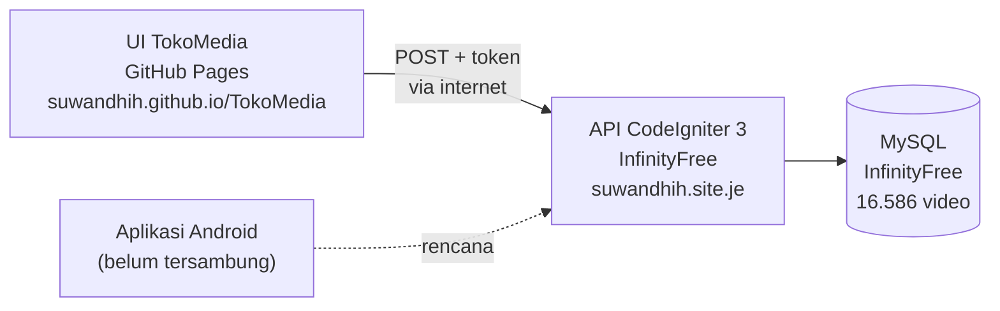

# 📋 RENCANA KERJA — TokoMedia

> **Berkas ini adalah catatan tunggal semua pekerjaan TokoMedia.**
> Setiap pekerjaan — selesai maupun belum — **wajib dicatat di sini**.
> Tujuannya: tidak perlu membaca ulang percakapan chat yang panjang dan sulit dibaca.
>
> **Aturan pencatatan:**
> - Pekerjaan **selesai** → tetap dicatat, beri status `✅ SELESAI` + tanggal.
> - Pekerjaan **baru** → langsung dicatat di bagian **TAHAP BARU** dengan status `⬜ BELUM`.
> - Pekerjaan **sedang jalan** → status `🔄 PROSES`.
> - Pekerjaan **tertahan** → status `⛔ TERTAHAN` + alasan.
>
> **Terakhir diperbarui:** 20 Oktober 2026

---

## 🗂️ Daftar Isi

| Bagian | Isi |
|---|---|
| [A](#a-ringkasan-status) | Ringkasan Status |
| [B](#b-arsitektur-sistem) | Arsitektur Sistem |
| [C](#c-riwayat-pekerjaan-selesai) | Riwayat Pekerjaan Selesai |
| [D](#d-tahap-baru) | **TAHAP BARU** |
| [E](#e-pertanyaan-terbuka-untuk-client) | Pertanyaan Terbuka untuk Client |
| [F](#f-catatan-penting) | Catatan Penting |

---

## A. Ringkasan Status

| # | Pekerjaan | Status | Tanggal |
|---|---|---|---|
| 1 | Rilis awal UI TokoMedia (Spatial Bento Edition) | ✅ SELESAI | 18 Okt 2026 |
| 2 | Logo resmi tokomedia.org + tagline MEDIA NUSANTARA | ✅ SELESAI | 18 Okt 2026 |
| 3 | AGENTS.md — aturan kerja & anti-looping | ✅ SELESAI | 18 Okt 2026 |
| 4 | Mode HP 430px sebagai default | ✅ SELESAI | 19 Okt 2026 |
| 5 | API Prioritas 1 — perbaikan sebelum deploy | ✅ SELESAI | 19 Okt 2026 |
| 6 | API Prioritas 2 — endpoint baru, pagination, sorting | ✅ SELESAI | 19 Okt 2026 |
| 7 | API Prioritas 3 — kualitas, keamanan, dokumentasi | ✅ SELESAI | 19 Okt 2026 |
| 8 | Sambung `index.html` ke API TokoMedia | ✅ SELESAI | 19 Okt 2026 |
| 9 | Dukungan PHP 5.6 (agar bisa dipasang di tokomedia.org) | ✅ SELESAI | 19 Okt 2026 |
| 10 | Panduan deploy InfinityFree | ✅ SELESAI | 19 Okt 2026 |
| 11 | Paket permintaan ijin akses CORS untuk tim IT client | ✅ SELESAI | 20 Okt 2026 |
| 12 | Keluarkan token API dari repositori publik | ✅ SELESAI | 20 Okt 2026 |
| 13 | Bersihkan token + password SMTP dari seluruh riwayat Git | ✅ SELESAI | 20 Okt 2026 |
| 14 | Verifikasi API sudah terpasang & jalan di InfinityFree | ✅ SELESAI | 20 Okt 2026 |
| 15 | Diagnosa penyebab CORS gagal di InfinityFree | ✅ SELESAI | 20 Okt 2026 |
| 16 | Buat berkas `rencanakerja.md` ini | ✅ SELESAI | 20 Okt 2026 |
| 17 | **Perbaiki CORS di InfinityFree (unggah ulang `config.php`)** | ⬜ BELUM | — |
| 18 | **Arahkan `apiBase` UI ke server InfinityFree** | ⬜ BELUM | — |
| 19 | **Perbarui `DEPLOY.md` (langkah token & troubleshooting CORS)** | ⬜ BELUM | — |
| 20 | **Putuskan status folder source code API client di repo publik** | ⬜ BELUM | — |
| 21 | **Rotasi token API (wajib — token lama masih bisa diakses)** | ⬜ BELUM | — |
| 22 | **Sambungkan aplikasi Android ke API** | ⬜ BELUM | — |

---

## B. Arsitektur Sistem



| Bagian | Tempat | Status |
|---|---|---|
| Tampilan (`index.html`) | GitHub Pages | ✅ Jalan |
| API (PHP CodeIgniter 3) | InfinityFree `suwandhih.site.je` | ✅ Terpasang & jalan |
| Database (16.586 video) | MySQL InfinityFree | ✅ Terisi |
| Aplikasi Android | Lokal (belum rilis) | ⬜ Masih data statis |

**Akun InfinityFree:** `if0_43217990` — domain `suwandhih.site.je` — HTTPS valid.

---

## C. Riwayat Pekerjaan Selesai

### C1. Rilis awal UI TokoMedia — ✅ SELESAI (18 Okt 2026)

- Commit `21975b1` — Rilis awal TokoMedia Spatial Bento Edition dan repositori lengkap.
- Berkas `index.html` tunggal, mandiri, tanpa dependensi luar.
- Dipasang di GitHub Pages: <https://suwandhih.github.io/TokoMedia/>

### C2. Logo resmi + tagline — ✅ SELESAI (18 Okt 2026)

- Commit `0dc2d21` — Samakan logo dengan versi resmi tokomedia.org (ikon toko, play, pause, teks utuh).
- Commit `5c74884` — Tagline menjadi **MEDIA NUSANTARA**.
- Commit `c84837c` — Judul halaman & preview OpenGraph: `TOKO MEDIA - Media Nusantara`.
- Commit `24364b6` — Hapus 4 kotak summary statistik di beranda.

### C3. AGENTS.md — ✅ SELESAI (18 Okt 2026)

- Commit `4c1e9ac` — Aturan kerja, anti-looping, estimasi waktu, standar TokoMedia.
- Commit `b1fadbf` (19 Okt) — Tambah aturan **A7: wajib selalu push ke GitHub**.

### C4. Mode HP 430px default — ✅ SELESAI (19 Okt 2026)

- Commit `c915111` — Mode HP 430px jadi default, layar penuh sebagai opsi kedua.
- Commit `31fdc61` — Sederhanakan label dock bawah: Beranda, Bahasa, Tonton, Aplikasi.

### C5. API Prioritas 1 — ✅ SELESAI (19 Okt 2026)

- Commit `7df5384` — Perbaikan sebelum deploy.
- Migrasi `database/20261019_priority3.sql`: tabel `videolike`, `user_login.password` → varchar(255), kolom `password_algo`.
- Library `Password_hash.php`: verifikasi SHA-1 lama, otomatis naik ke argon2id/bcrypt.

### C6. API Prioritas 2 — ✅ SELESAI (19 Okt 2026)

- Commit `aef77bc` — Endpoint baru + pagination + sorting.
- Pagination: `page` (mulai 1), `per_page` (maks 100, default 20); `limit`/`offset` lama tetap didukung.
- Sorting: `trending`, `popular`, `newest`, `oldest`, `unseen`, `default`.

### C7. API Prioritas 3 — ✅ SELESAI (19 Okt 2026)

- Commit `be68ffc` — Kualitas, keamanan, dokumentasi.
- Rate limit `api_rate_limit($bucket, $max=30, $window=60)` berbasis berkas di `application/cache/`.
- `api_client_id()`: POST `device_id` (disaring `[A-Za-z0-9_-]`, maks 64), jika tidak ada → `sha1(IP|User-Agent)`.

### C8. Sambung UI ke API — ✅ SELESAI (19 Okt 2026)

- Commit `482c348` — `index.html` memanggil API TokoMedia.
- Envelope balasan: `{status, message, data}` — `status` adalah kode **internal** (200 sukses / 201 validasi / 404 gagal); **HTTP status selalu 200**.
- Jika `TM_API_TOKEN` kosong → semua endpoint menolak `{status:404, message:"No Permission"}`.

### C9. Dukungan PHP 5.6 — ✅ SELESAI (19 Okt 2026)

- Commit `51b555b` — Agar bisa dipasang di hosting `tokomedia.org`.
- Diuji pada PHP 5.6.40 / 8.3.35 / 8.4.26 — 25/25 endpoint balas status 200.

### C10. Panduan deploy InfinityFree — ✅ SELESAI (19 Okt 2026)

- Commit `7c14130` — `20261014 API TM App/DEPLOY.md` + abaikan dump `.sql.gz`.
- Commit `7e5a430` — Siapkan deploy ke hosting PHP 8.3 + MySQL 8.
- Dump MySQL 8: `deploy-tokomedia-mysql8.sql` (26 MB, 34.996 INSERT, 15 tabel).
- ⚠️ Dump asli `20261014-tokomedia DB Structure and Data.sql` **jangan dipakai** — MySQL 8 menolak tanggal `0000-00-00`.

### C11. Paket permintaan ijin akses CORS — ✅ SELESAI (20 Okt 2026)

- Commit `60d1804` — Berkas `PERMINTAAN-IJIN-AKSES-API.md`.
- Isi: ringkasan masalah + hasil uji, kalimat permintaan, 4 varian script (PHP / Apache `.htaccess` / Nginx / pengikatan Origin), perintah verifikasi `curl`, catatan teknis.
- Hasil uji server client: `POST https://www.tokomedia.org/api/index.php/api/category/tree` → HTTP 200 tapi `Content-Type: text/html` (halaman login website, bukan JSON). **API belum dipasang di server client.**

### C12. Keluarkan token API dari repositori — ✅ SELESAI (20 Okt 2026)

- Commit `fb3e9a6` — Token dihapus dari `index.html`.
- Token lama: `AMRmryxy…M90J` (64 karakter) — **sudah tidak ada di berkas repo**.
- Pola baru:
  - `index.html` membaca `window.TM_CONFIG.token` (bukan token tertulis).
  - `config.local.js` — menyimpan token, **diabaikan Git** (`.gitignore`).
  - `config.example.js` — contoh/templat, ikut Git.
  - `loadLocalConfig()` memuat `config.local.js` sebelum `loadBootstrapData()`.
  - `apiPost()` menolak jalan jika token belum diisi.
- `DOKUMENTASI-API-TM-App.md` — ditambah bagian **"🚫 Jangan pernah tulis token di berkas yang ikut Git"**.

### C13. Bersihkan riwayat Git — ✅ SELESAI (20 Okt 2026)

- Alat: `git-filter-repo` 2.47.0.
- Dibersihkan: token API (ada di 9 commit) + password SMTP `info@tokomedia.org` (ada di 6 commit).
- Riwayat: 84 commit → **18 commit**. Force-push ke `main` berhasil.
- Verifikasi: pencarian kode GitHub = 0 hasil; situs live bersih; build Pages sukses.
- ⚠️ **Temuan penting:** GitHub **masih menyajikan objek commit lama lewat SHA langsung** (mis. `raw.githubusercontent.com/suwandhih/TokoMedia/1e031bf/index.html` → HTTP 200 berisi token utuh), walau commit itu sudah tidak terjangkau lewat ref/PR/fork. **Karena itu rotasi token wajib.**
- Cadangan riwayat lama: `C:\data\TokoMedia-backup-before-purge.bundle` (5.876.413 byte).

### C14. Verifikasi API di InfinityFree — ✅ SELESAI (20 Okt 2026)

- `POST http://suwandhih.site.je/index.php/api/category/tree` + token → `{"status":200,"message":"Success","data":[...]}` sebesar **68.819 byte** JSON asli, `Content-Type: application/json`.
- Tanpa token → `{"status":404,"message":"Parameter is needed","data":[]}`.
- HTTPS: `https://suwandhih.site.je/` → HTTP 200, sertifikat valid.
- **Kesimpulan: API sudah terpasang dan berfungsi.**

### C15. Diagnosa penyebab CORS gagal — ✅ SELESAI (20 Okt 2026)

**Gejala** — diuji dari `https://suwandhih.github.io/TokoMedia/`:

```
Access to fetch at 'https://suwandhih.site.je/index.php/api/category/tree'
from origin 'https://suwandhih.github.io' has been blocked by CORS policy:
No 'Access-Control-Allow-Origin' header is present on the requested resource.
```

**Hasil pemeriksaan:**

| Yang diperiksa | Hasil |
|---|---|
| Hook `Api_cors.php` jalan di server | ✅ Ya — header `Access-Control-Allow-Methods`, `Allow-Headers`, `Max-Age` muncul |
| Header `Access-Control-Allow-Origin` | ❌ **Tidak ada**, untuk semua origin yang diuji |
| `$config['cors_origins']` di server | ❌ Kosong / tidak ada |
| Zip `Backup/tokomedia-api-infinityfree.zip` | ✅ Sudah berisi CORS + `cors_origins` |
| Zip asli client `Backup/20261014 API TM App.zip` | ❌ Tidak ada CORS sama sekali |

**Akar masalah:** berkas `application/config/config.php` yang ada di server InfinityFree adalah **versi lama** (belum punya `$config['cors_origins']`), sedangkan `hooks.php` + `Api_cors.php` sudah **versi baru**. Hook jalan, tapi daftar origin kosong → tidak pernah cocok → header ACAO tidak pernah dikirim.

**Catatan penting:** ini server milik Bapak sendiri, jadi **tidak perlu minta tim IT client**. Cukup unggah ulang `config.php` dari zip ke `htdocs` lewat File Manager InfinityFree.

### C16. Buat `rencanakerja.md` — ✅ SELESAI (20 Okt 2026)

- Berkas ini dibuat sebagai catatan tunggal semua pekerjaan TokoMedia.

---

## D. TAHAP BARU

> Bagian ini untuk pekerjaan yang **belum dikerjakan**. Setiap tahap baru langsung dicatat di sini.

### D1. Perbaiki CORS di InfinityFree — ⬜ BELUM

**Tujuan:** agar UI di GitHub Pages bisa memanggil API tanpa diblokir CORS.

**Langkah:**
1. Masuk <https://dash.infinityfree.com/accounts> → akun `if0_43217990` → **File Manager**.
2. Buka folder `htdocs/application/config/`.
3. Cadangkan `config.php` lama (unduh dulu, simpan sebagai `config.php.lama`).
4. Unggah `config.php` dari `Backup/tokomedia-api-infinityfree.zip` (folder `application/config/`).
5. Pastikan `htdocs/application/config/hooks.php` juga versi baru (ada baris hook `Api_cors`).
6. Pastikan `htdocs/application/hooks/Api_cors.php` ada.
7. Uji: buka <https://suwandhih.github.io/TokoMedia/> → cek Console browser, tidak ada pesan CORS.

**Kriteria selesai:** header `Access-Control-Allow-Origin: https://suwandhih.github.io` muncul pada balasan API.

---

### D2. Arahkan `apiBase` UI ke server InfinityFree — ⬜ BELUM

**Tujuan:** UI memanggil server yang benar-benar hidup.

**Masalah:** di `index.html`, `apiBase` masih menunjuk `https://www.tokomedia.org/api/index.php/api` — server itu **belum memasang API** (balas halaman login HTML, bukan JSON).

**Langkah:**
1. Ubah `apiBase` menjadi `https://suwandhih.site.je/index.php/api`.
2. Uji tampilan di PC dan HP (aturan B5).
3. Commit & push (aturan A7).

---

### D3. Perbarui `DEPLOY.md` — ⬜ BELUM

**Tujuan:** panduan deploy tidak lagi menyesatkan.

**Yang perlu diperbaiki:**
1. Langkah 7 masih menyuruh menulis token **langsung di `index.html`** → ganti ke pola `config.local.js`.
2. Tambah bagian **Troubleshooting**: "CORS gagal / header ACAO tidak muncul" → penyebab `config.php` versi lama.
3. Tambah catatan: InfinityFree memakai **tantangan JavaScript AES** (`/aes.js`) → `curl` tidak bisa menguji API, harus lewat browser.
4. Tambah catatan: InfinityFree memblokir User-Agent non-browser.

---

### D4. Putuskan status folder source code API client — ⬜ BELUM

**Masalah:** 2.138 berkas source code API milik client (`20261014 API TM App/`) saat ini **bisa diakses publik** di GitHub. Contoh: `raw.githubusercontent.com/suwandhih/TokoMedia/main/20261014%20API%20TM%20App/application/controllers/api/Media.php` → HTTP 200.

**Catatan:** dump SQL dan berkas zip **tidak** publik (HTTP 404) dan sudah diabaikan Git.

**Pilihan:**
- **a.** Biarkan dulu — tidak masalah.
- **b.** Jadikan repositori **private**.
- **c.** Keluarkan folder `20261014 API TM App` dari repo (simpan lokal saja).

**Menunggu keputusan Bapak.**

---

### D5. Rotasi token API — ⬜ BELUM (WAJIB)

**Alasan:** token lama masih bisa dibaca lewat objek commit lama di GitHub (lihat C13). Selama belum dirotasi, token itu **harus dianggap bocor**.

**Langkah:**
1. Minta client menerbitkan token baru.
2. Minta client **mengikat token ke Origin** `https://suwandhih.github.io` (agar token tidak bisa dipakai dari domain lain).
3. Perbarui `config.local.js` (lokal) dan `htdocs/application/config/secrets.local.php` (server).
4. Hapus token lama dari server.

**Catatan:** permintaan ini sudah tertulis di `PERMINTAAN-IJIN-AKSES-API.md` poin 3.

---

### D6. Sambungkan aplikasi Android ke API — ⬜ BELUM

**Kondisi sekarang:**
- Proyek: `TokoMediaAndroid` — Kotlin + Jetpack Compose.
- `compileSdk = 37`, `minSdk = 24`, `targetSdk = 36`, `versionCode = 1`, `versionName = "0.1.0"`.
- Ijin `INTERNET` **sudah ada** di `AndroidManifest.xml`.
- **Belum ada kode jaringan sama sekali** — data masih statis di `MockData.kt`.
- **Belum ada pustaka HTTP** (Retrofit / OkHttp / Ktor) — perlu ditambahkan.

**Jawaban pertanyaan Bapak:** Android **tidak perlu script ijin tambahan**. CORS hanya berlaku di browser; aplikasi Android asli tidak mengirim header `Origin`, jadi tidak akan diblokir. Android memakai endpoint yang sama dengan UI.

**Langkah:**
1. Tambah Retrofit + OkHttp di `app/build.gradle.kts`.
2. Buat lapisan API (model + service) memakai envelope `{status, message, data}`.
3. Ganti `MockData.kt` dengan data dari API.
4. Uji di perangkat/emulator.

---

## E. Pertanyaan Terbuka untuk Client

| # | Pertanyaan | Status |
|---|---|---|
| 1 | Apakah data akan diperbarui berkala, atau hanya snapshot 14 Okt 2026? | ⬜ Belum ditanya |
| 2 | Apakah client masih akan menyediakan API live di `tokomedia.org`? | ⬜ Belum ditanya |
| 3 | Apakah client tahu source code API mereka bisa diakses publik di GitHub? | ⬜ Belum ditanya |
| 4 | Apakah client bersedia menerbitkan token baru + mengikatnya ke Origin? | ⬜ Belum ditanya |
| 5 | Apakah client mengizinkan Bapak self-host permanen, atau hanya untuk uji coba? | ⬜ Belum ditanya |

---

## F. Catatan Penting

### F1. Keamanan

- ❌ **Jangan pernah** menulis token API atau password di berkas yang ikut Git.
- ✅ Token disimpan di `config.local.js` (diabaikan Git) atau `secrets.local.php` (diabaikan Git).
- ❌ **Jangan pakai** `Access-Control-Allow-Origin: *` — sebutkan origin satu per satu.
- Token lama harus dianggap bocor sampai dirotasi (lihat D5).

### F2. Keunikan InfinityFree

1. Memblokir User-Agent non-browser → `curl` gagal (HTTP 000).
2. Memakai **tantangan JavaScript AES** (`/aes.js`, cookie `__test`, alih ke `?i=1`) → **`curl` tidak bisa mencapai API sama sekali**; hanya browser asli yang bisa.
3. Artinya: UI GitHub Pages **akan** jalan setelah CORS diperbaiki (browser menyelesaikan tantangan), tapi pengujian otomatis lewat `curl` tidak bisa.

### F3. Data

- Snapshot: **14 Oktober 2026, 12:12:38** — sumber MySQL 5.5.51, skema `tokomedia`.
- 15 tabel, 34.996 baris INSERT.
- Jumlah baris: `videodb` 16.586 · `routerdb` 17.107 · `category` 321 · `appdb` 275 · `videocomment` 640 · `user` 4 · `user_login` 4.
- Akar kategori: 1 = Film Isa Al-Masih (11.036 video) · 126 = Video Kitab Suci (5.401) · 304 = Ikatan Ilahi (110) · 127 = Clip Kitab Suci (39).
- ⚠️ **Catatan privasi:** `user_login` berisi 4 akun dengan hash SHA-1; `user` berisi alamat/provinsi/kota; `videocomment` berisi 640 komentar pengguna.

### F4. Aturan Kerja (ringkasan AGENTS.md)

| # | Aturan |
|---|---|
| A2 | Jangan mulai apa pun tanpa aba-aba Bapak. |
| A3 | Wajib sebut estimasi waktu sebelum mulai. |
| A6 | Tiap selesai satu butir → uji & lapor. |
| A7 | Wajib commit & push ke GitHub setiap selesai revisi dan uji. |
| B1 | Wajib uji sendiri dulu sebelum minta Bapak mengetes. |
| B2 | Uji hanya bagian yang direvisi. |
| B5 | Uji responsive PC & HP. |
| C1 | Dilarang meninggalkan kode coba-coba / tidak terpakai. |
| C3 | Tidak boleh ada berkas sampah atau sementara. |
